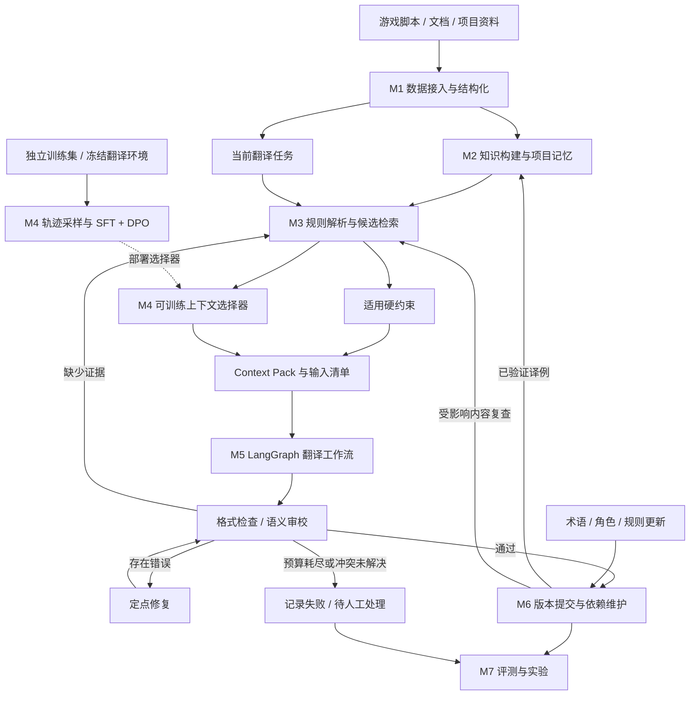

# 游戏本地化 Agent

面向长程游戏文本翻译的研究项目：结合多层翻译记忆、图引导检索、可训练的上下文选择工具与多模型协作，生成符合语境和项目规范的译文，并在术语、人物设定或本地化规则变化后维护已有结果。

**核心架构：LangGraph 执行编排 + DelTA 式记忆 + TransGraph 启发的检索 + Loong 启发的上下文选择训练 + 角色风格约束 + 版本与依赖驱动的局部修订。**

> 当前状态：以方案与协作设计为主；M1 已完成通用 CSV 导入和 Flare 固定快照文本整理（3,800 条中英对照、616 条待翻译），其余系统、训练与实验仍待实现。下文架构描述计划功能。更新日期：2026-10-30。
>
> 本文基于 [系统协作与实现细节详解](Research/游戏本地化Agent_系统协作与实现细节详解_2026-10-24.md)，将可训练上下文选择器纳入正式模块，并更新评测方案。旧文档中“Loong 仅为后续扩展”的范围约定，以本文为准；其余业务细节继续参考该文档。

## 1. 我们要实现什么

系统接收游戏台词、剧情文本、UI 字符串及可用的角色资料、术语表与风格要求，完成三个相互衔接的过程：

1. **建库**：保留文本位置和剧情结构，提取有来源的实体、术语、角色表达特征和块间关系，形成可检索、可版本化的项目记忆。
2. **翻译**：根据当前文本的角色、场景、分支和规则版本召回证据，选择有用上下文，执行翻译、检查、补充检索和有限轮修复，保存通过验证的译文。
3. **维护**：规则更新后定位受影响内容，复查并修订确实需要修改的译文，保留无需修改的结果、人工锁定和历史记录。

预期交付包括：可运行的翻译与维护流程、训练后的上下文选择器、公开数据与游戏数据适配器、统一评测工具、对照实验结果和可追溯运行记录。

重点验证三个问题：

- **翻译质量**：记忆、篇章关系和角色信息能否改善长文一致性与游戏语境表达？
- **上下文选择**：在相同候选池与预算下，学习得到的选择策略能否优于固定检索和未训练选择器？
- **持续维护**：版本、作用域和依赖记录能否降低规则更新的复查成本，并减少漏改、误改和回归？

## 2. 整体架构



**检索负责找到候选，选择器负责决定给模型哪些候选，执行图负责下一步做什么。** 三者使用同一组文本 ID、记忆 ID、版本号和预算信息。

硬术语、占位符、格式要求及适用的强制称呼规则由程序解析并直接进入输入包。学习策略只选择允许裁剪的上下文，不得删除硬约束、跨越分支限制或改写历史依赖。

## 3. 模块划分与交付边界

### M1：数据接入与结构化

**职责**：统一接入 GuoFeng、IWSLT2017 和自建游戏数据，保留文档顺序、来源、对齐与导出信息。

- 文档数据保留 book / document / chapter / sentence 的边界和原始 ID。
- 游戏数据以本地化文本的出现位置为翻译、修订和评测原子记录；对话按适用性关联场景和对话块，UI/物品不强制使用剧情层次。
- 保存说话人、听话人、场景、分支、文本类型、源版本及导出键；没有依据的字段保留 unknown。
- 源文与参考译文分离存储，参考译文仅向允许使用它的训练评分器和离线评测器开放。

**交付**：统一数据格式、数据清单、导入/导出适配器、固定的训练/开发/测试划分。

### M2：知识构建与项目记忆

**职责**：把原文和批准资料组织为可检索、可追溯的知识；管理译文生成过程中逐步积累的记忆。

| 记忆 | 内容 | 主要来源 |
| --- | --- | --- |
| 术语与实体 | 标准译名、别名、实体身份和适用条件 | 批准术语表、源文证据 |
| 摘要 | 场景/篇章进展、已译部分的双语摘要 | 源文及本次运行已验证译文 |
| 短期记忆 STM | 兼容的近期源译对 | 当前运行已提交结果 |
| 长期记忆 LTM | 相关历史译例与远距离上下文 | 当前运行或明确允许的种子 TM |
| 角色记忆 | 基础 style note、关系修正、场景表达条件 | 有证据的角色资料和源台词 |

采用小模型提取候选实体、关系及 style note，经过结构校验和必要核验后写入批准库。规则与记忆包含来源、作用域、版本和状态。关系图与向量索引引用同一批记录，正文不重复维护多份。

**交付**：持久化存储、知识提取流程、记忆读写接口、证据与版本记录。首版采用 SQLite 与关系表，检索索引可重建。

### M3：规则解析、图引导检索与 Context Builder

**职责**：在指定知识快照和译文读取水位下，找到对当前文本有效的规则与候选证据。

- 精确查询批准术语、角色身份与关系要求。
- 按分支、剧情阶段、说话人、听话人和文本类型过滤适用范围。
- 结合局部上下文、块间关系、词法和向量检索召回软证据，按 ID/版本去重。
- 将候选交给 M4，再把选择结果与硬约束组合成 Context Pack。
- 返回输入清单、证据来源、未解决项、冲突和 token 统计，支持按问题补检索。

图用于导航到相关原文与记忆。项目采用轻量关系检索，不要求部署完整 Microsoft GraphRAG。

**交付**：候选检索器、作用域解析器、Context Builder，以及固定 top-k / 排名融合基线。

### M4：Loong 启发的可训练上下文选择工具

**职责**：学习在有限预算内选择有助于翻译的证据。该模块包含在线选择服务和离线训练流程。

| 项目 | 本项目约定 |
| --- | --- |
| 观察 | 当前原文、任务元数据、候选证据正文与 ID、记忆类别、相关性信号、剩余预算 |
| 动作 | 从允许候选中选择有序证据 ID，或结束选择；首版使用有限步、结构化输出 |
| 可选内容 | 摘要、兼容译例、实体说明、相关原文、非强制角色证据 |
| 固定内容 | 已解析硬约束、必须保留的身份和关系要求 |
| 输出 | 选中 ID、顺序、简短选择理由、预算使用和策略版本 |
| 失败处理 | 非法 ID、超预算或服务失败时回退到固定选择器，并记录回退率 |

**训练范围只覆盖选择策略。** 提取器、候选检索配置、翻译模型、翻译提示词和评分协议在一次实验中保持固定，以便判断提升是否来自上下文选择。选择器与知识提取器可以使用相同规模的基础模型，但训练参数与运行职责独立。

训练路线为 **Loong 启发的 SFT 冷启动 → DPO 偏好优化**：

1. 在独立训练文档上构建候选池和可重放的记忆快照。
2. 对同一输入采样多个合法选择结果，交给冻结的翻译环境生成译文。
3. 根据下游翻译质量与约束检查筛选轨迹，构建 SFT 样本和 chosen/rejected 偏好对。
4. 训练选择器，在独立开发集上选定模型、预算与偏好阈值。
5. 冻结策略后，在测试集执行完整顺序翻译与评测。

偏好构造以翻译质量为主；质量差异很小时优先保留上下文更少的方案。非法动作和硬约束违规先行过滤，不能用节省 token 抵消。成本同时统计选择器自身调用与下游翻译开销。初期使用训练集的 sCOMET 反馈，开发集结合 dCOMET 与独立 Judge 检查是否只优化了单一指标。

Loong 原方法涉及上下文选择和利用的联合过程；本项目将其适配为独立选择工具，不能直接视为原方法的完整复现。这里的强化学习相关内容具体落地为 **SFT＋DPO 偏好学习**；若另行实现在线 GRPO/PPO，需要新增训练环境和实验，不能将 DPO 实验标成 GRPO/PPO。

**交付**：选择器接口、采样与偏好数据构造、训练配置、策略 checkpoint、固定/提示式/SFT/DPO 选择器对照。

方法来源：[Loong 论文，EMNLP 2026](https://aclanthology.org/2026.emnlp-main.329/)；[LoongDocMT 代码与训练入口](https://github.com/YutongWang1216/LoongDocMT)。

### M5：多模型翻译、审校与执行编排

**职责**：用 LangGraph 管理任务状态、条件路由、有限重试、恢复和模型调用预算。

| 角色 | 工作 | 触发时机 |
| --- | --- | --- |
| Knowledge Builder | 小模型提取候选知识 | 建库或源文变化时 |
| Context Selector | 训练后的策略选择上下文 | 初次打包或补检索后 |
| Translator | 根据原文与 Context Pack 生成译文 | 无可直接复用的兼容 TM 时 |
| Reviewer | 定位语义、术语、风格及上下文问题 | 生成或修复后 |
| Repairer | 根据确认的问题修订当前译文 | 检查发现具体错误时 |
| Coordinator / QA | 路由、格式检查、预算和停止条件 | 由程序持续管理 |

正常路径为：加载任务 → 构建上下文 → 翻译/复用 → 硬规则检查 → 语义审校 → 提交。证据不足触发定向检索；已有证据下的错误触发修复；冲突未解决或预算耗尽时返回明确状态。

强模型可共享后端，但翻译、审校和修复采用独立调用与任务输入。知识提取小模型初始候选为 Qwen2.5-7B-Instruct；选择器基础模型及强模型在资源明确后通过开发集确定，模型 ID、版本和生成参数统一配置。

**交付**：端到端执行图、模型适配层、结构化问题反馈、调用预算、持久化恢复和运行日志。

### M6：版本、依赖与选择性修订

**职责**：保证每条译文可追溯，并维护规则变化后的历史结果。

- 保存源版本、知识快照、输入清单、译文版本与验证记录。
- 记录实际供给的上下文与适用规则；检索到但未供给的项仅进入检索日志。
- 通过旧版本反向依赖、旧/新作用域和补充检索共同发现复查候选。
- 区分 no_change、需要修订、锁定建议和未解决项，避免对所有候选重新生成。
- 让过期摘要/TM 失效并按需重建；保留旧生成来源和新验证状态。
- 提交时检查预期版本，支持幂等写入、回滚与导出冲突报告。

**交付**：更新事件处理、影响范围分析、修订 diff、保护与提交逻辑、审计记录。

### M7：评测与实验管理

**职责**：统一运行数据适配器、基线和消融实验，计算主指标及业务诊断指标，生成可复查结果。

**交付**：sCOMET、dCOMET、LLM-as-a-Judge 适配器；数据与模型配置记录；逐条译文、文档评分、失败统计、成本记录及实验汇总。

评测器与在线 Reviewer 分离。在线审校通过只表示工作流完成，不能当作最终实验质量结论。

## 4. 评测数据

计划使用以下三个评测集，分别报告结果，不把不同语言方向的分数混成一个总分。

| 数据集 | 初始方向与评测单元 | 验证重点 | 接入约定 |
| --- | --- | --- | --- |
| **GuoFeng Webnovel V1 Test 2** | Zh→En；按章节评测并保留书籍边界 | 长篇叙事、远距离上下文、专名与风格一致性 | 使用 V1 中与训练书籍不同的第二组测试数据；下载后固定实际文件名和 ID |
| **IWSLT2017** | 优先 En→Zh；以完整 talk/document 为单位 | 通用文档翻译与跨领域泛化 | 对齐 DelTA/Loong 使用的数据组织；实验前冻结具体 test split、文档清单与方向 |
| **自建游戏数据** | 优先 En→Zh；完整场景或兼容剧情分支 | 人物口吻、关系、术语、格式约束和更新维护 | 制作源文、参考译文、批准规则及必要元数据；按场景/任务线划分 |

GuoFeng 的“Test 2”在本项目中指 V1 的第二组测试划分，不能与 GuoFeng V2 或任意两个测试文件混用。官方说明 V1 为中文到英文、包含句级对齐；最终统计以取得的数据和 manifest 为准。[官方数据说明与获取入口](https://github.com/longyuewangdcu/GuoFeng-Webnovel)。

IWSLT2017 可从 [DelTA 数据入口](https://github.com/YutongWang1216/DocMTAgent/tree/main/data) 与 [Loong 数据入口](https://github.com/YutongWang1216/LoongDocMT/tree/main/data) 核对具体处理版本。运行前确认 talk/document 边界，不能将随机句子拼成文档。

自建游戏集包含两部分：**静态翻译集**和**规则更新事件集**。前者有可供主指标评分的参考译文；后者另外标注应复查、确实需改、不应修改及锁定内容，用来评价维护能力。真实样本与人工构造诊断样本分别报告。

### 训练、开发与测试隔离

- Loong 式选择器训练初始考虑采用独立的 **News Commentary v18.1** 文档语料，参考作者采样流程；具体方向、规模和获取版本在训练前登记。游戏领域适配只能使用自建训练部分。
- GuoFeng Test 2、IWSLT2017 的选定测试集和自建游戏 test 均不用于 SFT、DPO 偏好构造、奖励调参或选模型。
- 数据按书籍、文档或场景分组划分并去重，避免同一上下文跨训练与测试。
- 测试参考译文不进入角色笔记、翻译记忆、图检索、选择器、Translator 或在线 Reviewer。
- 每个方法拥有独立的运行记忆；只能累积本方法已验证译文。跨章节记忆若启用，固定书内顺序并在书籍边界重置。
- 公开文档模式默认逐段顺序处理，只读取允许的前序历史；游戏模式可读取事先提供的源脚本和批准资料。所有对照共享同一源侧可见范围。
- GuoFeng 等数据按原始获取条件使用；仓库发布适配脚本和清单，不直接提交受限原文、参考译文或私有游戏资料。

## 5. 评测指标与质量保证

### 三项主指标

| 指标 | 用途 | 实现与报告要求 |
| --- | --- | --- |
| **sCOMET** | 句级翻译质量 | 使用 source / hypothesis / reference 对齐记录；初始采用 `wmt22-comet-da`，冻结 checkpoint 和版本；同时给出句级整体均值与文档宏平均 |
| **dCOMET** | 使用篇章上下文的翻译质量 | 参考 Loong 与 doc-mt-metrics 的实现；固定文档 ID、上下文窗口、截断与聚合配置；禁止跨文档或互斥分支取上下文 |
| **LLM-as-a-Judge** | 长文整体质量和难以由单一自动指标覆盖的现象 | 固定 Judge、提示词和评分标准，匿名评估；保存各维度分数和依据 |

**dCOMET 不是把 sCOMET 分数在文档内求平均。** 本项目采用能在评分时读取篇章上下文的 COMET 扩展。评分器可按协议使用参考侧历史，但这些信息仅存在于离线评测过程，不能流回翻译系统。[doc-mt-metrics 方法与实现](https://github.com/amazon-science/doc-mt-metrics)。

LLM Judge 的通用维度参考 Loong：总体质量、衔接、连贯、风格一致性、术语一致性。游戏集额外报告角色/关系表达及本地化约束符合度，不与通用五维均分混算。所有方法的 Judge 获得相同的源文、资料和参考可见条件；长文超限时统一按预定义窗口评分并报告覆盖率。[Loong 评测入口](https://github.com/YutongWang1216/LoongDocMT#evaluation)。

### 业务与效率诊断

三项主指标之外，同时记录以下指标，以解释系统是否完成本地化任务：

- **约束正确性**：术语符合率、占位符/标签保留率、长度违规率、错误分支证据混入率。
- **选择器行为**：上下文 token、候选/选中条数、非法动作率、回退率，以及小规模标注集上的必要证据覆盖率。
- **修订质量**：应复查项召回率、需改项修复率、不应修改项改动率、回归与人工锁定保护。
- **实际成本**：模型调用次数、输入/输出 token、端到端耗时、失败与重试；分别报告离线建库、训练、在线翻译及更新成本。

质量保证包括：抽样人工盲评、Judge 分歧复查、源译对齐检查、规则/格式测试和运行恢复测试。比较结果同时报告完整率和未解决任务，不能静默丢弃失败样本后只比较成功项。参考译文对齐缺失的处理规则在测试前固定并记录。

### 对照与消融

| 实验 | 主要目的 |
| --- | --- |
| 同一强模型直接翻译 | 衡量基础翻译能力 |
| DelTA 记忆基线 | 衡量多层记忆带来的变化 |
| 项目系统 + 固定选择器 | 建立可复现的完整工程基线 |
| 项目系统 + 未训练提示式选择器 | 区分模型选择能力与训练收益 |
| 项目系统 + SFT 选择器 | 检验冷启动监督学习 |
| 项目系统 + SFT/DPO 选择器 | 检验偏好优化增益 |
| 去除图检索 / 显式角色 note | 分别检验关系检索与信息组织价值 |
| 更新时全量复查 / 检索复查 / 依赖＋检索复查 | 比较维护质量和成本 |

选择器对照固定候选池、硬规则、翻译后端、生成参数和上下文预算；报告首次生成与最终修复后的质量，避免后续修复掩盖选择器差异。先在固定记忆快照上比较单步效果，再以各方法独立演化的记忆进行端到端实验。

## 6. 小组协作与计划目录

建议按四条责任线协作，每项任务指定一位负责人和一位复核人：

| 成员责任线 | 负责模块 | 优先产出 |
| --- | --- | --- |
| A：数据与知识 | M1、M2 | 数据协议、评测划分、人工知识样例、知识构建 |
| B：检索与选择训练 | M3、M4 | 固定候选检索、选择器接口、轨迹数据、SFT/DPO |
| C：Agent 与维护 | M5、M6 | 模型适配、翻译闭环、状态恢复、版本与更新流程 |
| D：评测与集成 | M7、公共契约复核 | 三项主指标、基线运行、质量检查、实验汇总 |

以下基础目录已建立，空目录以 `.gitkeep` 保留；代码、配置和命令入口待各模块开发时添加：

```text
.
├── README.md
├── AGENTS.md                     # 编码助手共享约定
├── CONTRIBUTING.md               # 人工协作流程占位
├── .gitignore                    # 本地环境与运行产物忽略规则
├── docs/                         # 协作文档占位页
├── Research/                     # 系统设计与调研资料
├── Proposal/                     # Proposal 与相关材料
├── src/localization_agent/
│   ├── schemas/                  # 公共数据结构与跨模块契约
│   ├── data/                     # M1 数据接入与导出
│   ├── memory/                   # M2 知识、记忆及存储
│   ├── retrieval/                # M3 规则、图/词法/向量候选与打包
│   ├── selection/                # M4 在线选择策略与回退
│   ├── workflow/                 # M5 执行图、翻译、审校与修复
│   ├── maintenance/              # M6 版本、依赖和规则更新
│   ├── evaluation/               # M7 指标与实验汇总
│   └── models/                   # 共享模型接口、缓存与计费
├── training/                     # M4 采样、偏好构造、SFT/DPO
├── configs/                      # 模型、数据、预算和实验配置
├── prompts/                      # 可版本化提示词
├── scripts/                      # 数据、训练、推理、评测入口
├── tests/                        # 契约、关键业务边界与集成验证
└── artifacts/                    # 本地结果与日志，大文件默认不入库
```

先共同固定 `Occurrence`、`MemoryRecord`、`ReadView`、`CandidatePool`、`SelectionResult`、`ContextPack`、`TranslationOutcome`、`UpdateReport` 八类接口。模块通过这些结构交换数据，避免各自维护不同字段含义。

协作约定：

- 一个 Issue 对应一个可验收任务；使用短期功能分支，通过 PR 合入主分支。
- PR 说明行为变化、关联模块和验证结果；修改公共 schema、数据划分或评测口径时，由受影响模块负责人复核。
- 使用模拟模型先完成接口集成，再接真实模型；模拟结果不计入翻译实验。
- 数据清单、配置和提示词进入版本管理；API 密钥、原始受限数据、权重及大规模日志不入库。
- 每次正式实验保存代码提交、数据清单、模型/策略版本、提示词 hash、预算、随机种子及指标版本。
- 四人使用 Codex 开发时，也以相同接口、Issue 和 PR 验收；生成代码由负责人检查后合并。

## 7. 分步实施

| 阶段 | 目标 | 验收结果 |
| --- | --- | --- |
| 1. 接口与数据样例 | 固定公共结构，准备少量可解释文档/游戏样例 | 数据、记忆、检索、翻译、评测可以通过模拟后端串联 |
| 2. 固定策略闭环 | 跑通记忆、硬规则、翻译审校和提交；接入三项指标 | 获得真实端到端基线与完整日志 |
| 3. 图检索与轨迹采样 | 加入有证据的关系和角色 note；冻结一版候选池与翻译环境 | 产出独立训练轨迹及可核查偏好对 |
| 4. 选择器训练 | 完成 SFT、DPO 与开发集选择，同时推进规则更新模块 | 可加载的策略版本、固定/SFT/DPO 对照及更新闭环 |
| 5. 冻结与正式评测 | 固定数据、模型、预算和评分协议 | 三个测试集结果、维护实验、质量与成本分析 |

团队按 4 人、每人每天约 2 小时、20 天规划，约 160 人时。训练采样和评测应在固定策略闭环形成后尽早启动；GPU/API 资源、具体模型和全量测试开销需在阶段 1 核算。若调整实验规模，预先冻结完整文档子集并明确标注，保留选择器训练这条正式工作线。

## 8. 参考论文与仓库

| 用途 | 论文 / 文档 | 仓库 | 本项目借鉴范围 |
| --- | --- | --- | --- |
| 执行编排 | [LangGraph 文档](https://docs.langchain.com/oss/python/langgraph/overview) | [langgraph](https://github.com/langchain-ai/langgraph) | 状态、条件路由、持久化 |
| 多层记忆 | [DelTA，ICLR 2025](https://proceedings.iclr.cc/paper_files/paper/2025/hash/285149554f6fbed6e2f9ec72d131bd23-Abstract-Conference.html) | [DocMTAgent](https://github.com/YutongWang1216/DocMTAgent) | 记忆类型、独立基线及数据入口 |
| 图引导检索 | [TransGraph，EACL 2026](https://aclanthology.org/2026.eacl-long.75/) | 本轮未确认作者实现入口 | 按论文适配块间关系和邻域检索 |
| 上下文选择训练 | [Loong，EMNLP 2026](https://aclanthology.org/2026.emnlp-main.329/) | [LoongDocMT](https://github.com/YutongWang1216/LoongDocMT) | Observe-and-Act、轨迹偏好、SFT/DPO 与评测入口 |
| 图与记忆工程参考 | [GRAFT，EMNLP 2025 Industry](https://aclanthology.org/2025.emnlp-industry.166/) | [graft](https://github.com/himanshu-dutta/graft) | Agent 模块与工作流组织参考 |
| 多模型职责分离 | [AgentFlow 项目与论文](https://agentflow.stanford.edu/) | [AgentFlow](https://github.com/lupantech/AgentFlow) | Worker 契约与职责划分 |
| 按需激活 | [Puppeteer，NeurIPS 2025](https://proceedings.neurips.cc/paper_files/paper/2025/hash/f1320d2e2842169c6fc89dcbd80e94d0-Abstract-Conference.html) | [ChatDev / puppeteer](https://github.com/OpenBMB/ChatDev/tree/puppeteer) | 根据状态激活有限 Worker |
| 反馈与修订 | [TEaR，NAACL 2025 Findings](https://aclanthology.org/2025.findings-naacl.218/)；[LLMRefine，NAACL 2024 Findings](https://aclanthology.org/2024.findings-naacl.92/) | [TEaR](https://github.com/fzp0424/self_correct_mt)；[translation-agent](https://github.com/andrewyng/translation-agent) | 评估→修订闭环、可执行错误反馈和反思基线 |
| 句级评价 | [COMET，EMNLP 2020](https://aclanthology.org/2020.emnlp-main.213/) | [COMET](https://github.com/Unbabel/COMET) | sCOMET 评分 |
| 篇章评价 | [Document-Level MT Metrics，WMT 2022](https://aclanthology.org/2022.wmt-1.6/) | [doc-mt-metrics](https://github.com/amazon-science/doc-mt-metrics) | dCOMET 上下文评分 |
| 多维 Judge 参考 | [M-MAD，ACL 2025](https://aclanthology.org/2025.acl-long.351/) | [M-MAD](https://github.com/SU-JIAYUAN/M-MAD) | 多维评分设计；完整辩论流程不作为默认依赖 |
| 训练与推理工具 | [LLaMA-Factory](https://github.com/hiyouga/LLaMA-Factory) | [vLLM](https://github.com/vllm-project/vllm) | 选择器训练与模型服务 |

参考方法、直接代码复用和本项目新增设计在实现与报告中分别注明。引用或移植代码时记录上游提交与许可证；第三方论文中的收益不视为本项目已经取得的结果。

## 9. 项目文档

- [AGENTS.md](AGENTS.md)：Codex 共享开发指令、模块边界与研究约束。
- [CONTRIBUTING.md](CONTRIBUTING.md)：人工协作开发流程占位页。
- [协作文档入口](docs/README.md)：任务、接口、数据、训练、评测、实验、环境、决策和交接文档的用途与维护位置；当前各页为待填写占位。
- [系统协作与实现细节详解](Research/游戏本地化Agent_系统协作与实现细节详解_2026-10-24.md)：业务对象、上下文、审校、版本依赖和恢复机制。
- [项目设计与实现 Roadmap](Research/游戏本地化Agent_项目设计与实现Roadmap_2026-10-23.md)：既有计划与实验设计，训练范围及主评测方案以本 README 更新为准。
- [多模型协同与长程 Agent 架构推荐](Research/多模型协同与长程Agent架构推荐_2026-10-23.md)：多模型分工相关调研。
- [P0 论文与开源项目详解](Research/P0论文与开源项目详解及架构复现建议_2026-10-22.md)：早期选型参考，仓库发布状态以最新核验为准。

当前尚无完整系统的安装与启动入口。M1 的 CSV 导入和 Flare 适配仅使用 Python 3.9+ 标准库，无需安装第三方包。

在仓库根目录运行通用 CSV 导入和离线检查：

```bash
PYTHONPATH=src python3 scripts/import_localization_csv.py examples/localization.csv --dataset-id demo --output outputs/csv_demo
PYTHONPATH=src python3 -m unittest discover -s tests -v
```

CSV 主要格式为“类型、英文原文、中文参考译文、本地化上下文”，也接受 `text_type/source_text/reference_text/context` 英文表头。原文、参考分别写入 `source.jsonl` 和 `references.jsonl`；缺少中文时只保留源侧记录。输出目录需新建或为空。示例是自建演示文本，不作为实验语料或质量结果。接口、JSON 上下文及多文件用法见 [CSV 导入说明](docs/DATA.md#通用-csv-导入)；Flare 的原始 ID/条件/源位置仍保存在后台。

Flare 全量整理需先下载公开文本快照（网络步骤），或使用已有本地输入：

```bash
python3 scripts/download_flare_sources.py
PYTHONPATH=src python3 scripts/build_flare_full.py
```

Flare 输出 4,416 个使用位置，其中 3,800 条中英、616 条缺少中文。范围与复现说明见 [Flare 全量整理](docs/DATA.md#flare-全量本地化文本-v02)；原 47 条样例入口保留用于历史本地快照。未下载原始输入时，Flare 集成检查会明确跳过，CSV 检查始终运行。以上不表示实际游玩路径核验、译文人工评级或训练/评测已完成。
