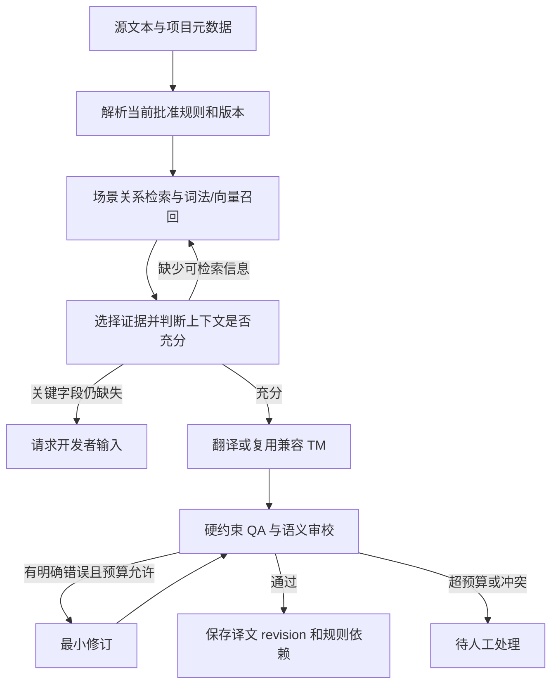

# P0 论文与开源项目详解：面向游戏本地化 Agent 的架构复现建议

日期：2026-10-22  
对应材料：[原调研报告](游戏本地化Agent调研报告_2026-10-22.md)、[20 天 Roadmap](游戏本地化Agent_20天实现Roadmap_2026-10-22.md)、[Proposal](../Proposal/LLM_Proposal.pdf)。

适用条件：4 人，每人每天约 2 小时，20 天约 160 人时；硬件和 API 预算尚未确定。

## 0. 如何阅读和使用这份文档

**推荐方案是：LangGraph 管执行，DelTA 提供翻译记忆基线，TransGraph 提供图引导检索思路，HiAgent 提供工作记忆组织思路；项目自己的版本、作用域、依赖与修订机制构成研究主线。** A-Mem 和 LongMemEval 分别补充记忆组织与评测设计；SwiftSage、RouteLLM、LLMCompiler 用于理解效率方案，按资源选择性实现。

原调研报告共有 **9 篇明确标为 P0 的论文**。这里的 P0 表示“优先理解、直接影响设计”，不表示 9 篇都必须复现。框架表中的项目并未逐项标 P0，本文另外介绍最适合落地的 LangGraph、translation-agent，以及值得参考的 FolioLoom；再补充原报告 P1 的 LLMRefine，帮助设计审校接口。

本文区分四种工作：

| 工作类型 | 含义 | 可以怎样写进报告 |
| --- | --- | --- |
| 完整复现 | 尽量匹配原数据、模型、训练/推理、指标和设置，复核论文结果 | “复现某论文的某个实验配置”，同时列出差异 |
| 方法适配 | 保留关键算法，换 backbone、领域、数据或运行接口 | “DelTA 适配版”等，不能视为原论文同条件结果 |
| 模块复现 | 实现论文中的一个独立机制，单独验证 | “复现子目标工作记忆机制”，不代表复现全部 HiAgent |
| 设计借鉴 | 参考思想，重新设计自己的实现 | “受 TransGraph 启发的游戏关系检索”，不称原版 TransGraph |

下面每节都将**论文机制**与**面向本项目的建议设计**分开。示例中的游戏人物、术语、规则和 JSON 均为说明性设计，不是论文数据，也不是已经实现的系统输出。

核对方式：阅读论文正文的方法部分、官方论文页面、作者项目及可访问的部分源码；未安装或运行这些外部系统，未复核其性能数字。因此“可获取代码”与“已验证能在我们的环境运行”是两种状态。工程仓库会更新，正式采用时仍需固定 commit。

### 0.1 九篇 P0 的整体定位

| 工作 | 发表类型 | 主要回答的问题 | 对本项目的推荐 |
| --- | --- | --- | --- |
| DelTA | ICLR 2025 | 顺序翻译时怎么组织不同粒度的记忆？ | **优先适配，作为强基线和记忆起点** |
| TransGraph | EACL 2026 主会长文 | 怎么沿关系寻找比相邻文本更有用的上下文？ | **实现游戏领域的轻量图引导检索** |
| Loong | 2026 预印本 | 检索后如何进一步选择、利用上下文？ | 借鉴显式选择协议，暂不复现训练 |
| HiAgent | ACL 2025 主会长文 | 多步 Agent 如何控制工作历史增长？ | **按子目标压缩工作记忆，保留证据恢复入口** |
| A-Mem | NeurIPS 2025 主会 | 记忆如何形成结构化笔记及关联？ | 借鉴笔记与链接；自动演化作为可选项 |
| LongMemEval | ICLR 2025 | 如何检测更新失效、时间范围与证据不足？ | **借鉴测试协议，不替代翻译评测** |
| SwiftSage | NeurIPS 2023 | 快速执行与强模型规划怎样分工？ | 条件允许时做有限的疑难升级 |
| RouteLLM | ICLR 2025 | 哪些请求值得交给更强、更贵的模型？ | P1：校准路由，不直接照搬通用阈值 |
| LLMCompiler | ICML 2024 | 哪些工具可以并行，哪些必须等待？ | 借鉴依赖调度；首版固定并发结构即可 |

## 1. DelTA：翻译记忆最值得先落地的研究起点

**论文：** *DelTA: An Online Document-Level Translation Agent Based on Multi-Level Memory*，Yutong Wang 等，ICLR 2025。  
**入口：**[论文全文](https://arxiv.org/html/2410.08143v2)、[作者仓库 DocMTAgent](https://github.com/YutongWang1216/DocMTAgent)。

### 1.1 论文解决什么问题

长文翻译需要利用历史，但把整篇或大量前文放进输入，可能增加遗漏和干扰。DelTA 采用“有文档上下文的逐句翻译”，并用四类记忆提供专名、全局进展、近期信息和相关旧例。它的重点是**有组织地读取和更新翻译历史**，而非通过大量 Agent 讨论获得答案。[论文第 3–4 节](https://arxiv.org/html/2410.08143v2#S4)

### 1.2 四类记忆怎样协作

| 原论文组件 | 保存的信息 | 在游戏项目中的直观对应 |
| --- | --- | --- |
| Proper Noun Records | 已出现专名及其初次译法 | 已确认实体的中英译名 |
| Bilingual Summary | 已处理内容的源语、目标语摘要 | 当前场景进展的简短摘要/游戏已翻译的主要内容，风格语调 |
| Short-Term Memory | 近期源译文句对 | 同一场景最近几条台词 |
| Long-Term Memory | 较早的源译文句对，检索相关例子 | 相同实体或表达方式在较远位置的译例/相邻几个场景的内容 |

按句推进时，系统先读取当前可见记忆，再翻译，随后更新记忆。专名记录用于一致性；摘要用于压缩背景；短期记忆偏局部连续性；长期记忆偏远距离复用。四者不是四个独立大模型，（是否可以用小模型代替？）也不是四个必须部署的服务。[作者组件说明](https://github.com/YutongWang1216/DocMTAgent)

### 1.3 我们建议复现到哪一步

先做一个隔离的 `DelTABaseline`，保留其四类记忆与顺序处理机制，再通过统一 `ModelAdapter` 调用团队选定模型。基线的数据读写、模型费用和异常处理使用自己的公共设施，记忆选择与更新逻辑保持可追踪。

建议自己设计的接口：

```python
context = delta_memory.retrieve(source, document_id)
target = model.translate(source, context)
delta_memory.observe(source, target)
```

这只是概念接口，不是作者仓库中的现成 API。初次可行性检查先控制在 roadmap 的约 4 人时内：跑通 20 条开发样例并观察记忆变化。超过上限仍有环境障碍就记录阻塞，保留主系统；不能把一个缺少摘要和长短期记忆的普通 RAG 命名为 DelTA。

### 1.4 怎么接到我们的架构

**基线与 proposed memory 必须分开。** 基线保留原方法的主要假设；项目方法再做以下扩展：

1. 专名的键从简单字符串扩为 `entity_id/sense_id`，同形词不混用。
2. 译名增加 approval、scope、version，不把“模型第一次这样翻”自动当成正式批准。
3. TM 复用检查场景功能、人物关系和约束，相关不等于可直接复用。
4. 摘要只表达理解结果；数值、否定、条件、锁定词和原始证据另外保存。
5. 每个输出记录所应用规则的版本，为之后更新提供依赖索引。

例如 “Sentinel” 可以是某一组织名，也可以指普通守卫。全局绑定一个中文词容易产生一致但错误的译文；我们的扩展必须先判断实体和词义，再落实一致性。

### 1.5 最小验证与代码入口

用同一模型比较：无记忆、只用近期台词、DelTA 适配版。开发样例至少包含实体多次复现、代词指代和相隔若干条后的再次出现。记录术语正确性、含义错误、请求次数和输入长度；句数对齐不代表每句内部没有漏掉语义。

优先阅读作者仓库的 `prompts/`、`infer/`、`eval_consistency/`，其 README 明确列出对应用途，代码采用 Apache-2.0。[仓库结构与运行说明](https://github.com/YutongWang1216/DocMTAgent) LTCR-1 的现有实现可以研究，但采用前要核对语言处理与统计定义，不能把它直接等同于游戏中的 entity/sense 条件正确率。

**推荐程度：最高。** 它给项目提供可解释的记忆起点和真正接近的基线，但不处理你们完整的审批、分支作用域和历史修订需求。

## 2. TransGraph：图引导上下文检索，值得实现轻量版本

**论文：** *Discourse Graph Guided Document Translation with Large Language Models*，Viet Thanh Pham 等，EACL 2026。  
**入口：**[论文页面](https://aclanthology.org/2026.eacl-long.75/)、[论文 PDF](https://aclanthology.org/2026.eacl-long.75.pdf)。

### 2.1 论文的图究竟是什么

TransGraph 的节点主要是**文档文本块**，边表达文本块之间的篇章关系。它并非简单地把人名、地名放进一个实体图。流程先分块，再在受限窗口内判断块对关系，最后按稳定次序翻译，利用当前块的直接入邻居及关系标签组织上下文。[论文第 2 节](https://aclanthology.org/2026.eacl-long.75.pdf)

核心思想可以概括为：不要只问“什么片段最相似”，还要问“这段内容为什么与当前翻译相关”。关系标签可以帮助模型区分指代来源、术语定义或解释性内容。

### 2.2 为什么适合游戏，又为什么不能原样照搬

游戏脚本往往已有场景、speaker、event 等结构。我们可以优先用这些确定性信息，而不必让 LLM 为所有文本对生成关系。游戏又存在互斥分支，同一个线性邻居不一定是剧情上有效的邻居。

建议采用两种相互关联、用途不同的结构：

| 结构 | 节点/边 | 功能 |
| --- | --- | --- |
| 轻量游戏语义图 | 字符串、角色、场景、实体；`SPOKEN_BY/IN_SCENE/REFERS_TO` | 找相关源文和规则证据 |
| 版本依赖图 | 规则版本、译文 revision、TM 复用 | 更新后定位需要复查的输出 |

从文本块篇章图改成游戏元数据图属于**受 TransGraph 启发的领域适配**，不能称为严格复现 TransGraph。若想验证原论文的关系标注机制，可在一小段连续源文上另做试验，但它不是主系统开工前提。

### 2.3 推荐的最小算法

```text
输入：当前字符串、scene、speaker、已确认实体、snapshot
1. 找到与它相连的场景、人物和实体节点。
2. 排除不适用的分支/剧情阶段，未知范围单独标记。
3. 沿一跳关系找到原文证据；必要时受限扩展一跳。
4. 将片段、关系类型、来源 ID 组织成 context records。
5. 与词法/向量候选合并，在固定预算内选择。
```

关系记录至少有 `source_node/target_node/relation/evidence_id/scope/approval`。SQLite 的边表和索引即可处理当前规模，不需要先部署 Neo4j。模型提出的新关系只有附证据且通过核验后才能成为可靠检索依据。

例子：某条台词的 speaker 是 Captain A，听话人是 Player B。关系检索应先取该人物对在当前阶段的称呼规则，而不是取 Captain A 在另一个友好分支中语义最相似的台词。

### 2.4 怎样验证图有用

比较“词法＋向量检索”与“相同检索＋关系邻居”。双方使用同一语料、元数据、模型与上下文 token 预算；简单元数据过滤也要共同保留，避免把有无 speaker 信息误当成图算法收益。

记录上下文错误率、术语正确率、有效证据召回、输入 tokens 和建图成本。若增加关系标签本身也是主张，再比较“相同片段无标签”与“有标签”，将取到了好材料和标签表达的效果分开。

本次在所读论文 PDF 中未找到明确作者代码入口，未核实可直接运行的官方实现。因此推荐从论文机制实现小模块，不把未知仓库当作可立即复用的底座。

**推荐程度：高。** 重点是一小段能测出价值的关系检索，而不是大规模自动建图。

## 3. Loong：理解自适应上下文选择，但本轮不复现训练

**论文：** *Loong: A Human-Like Long Document Translation Agent with Observe-and-Act Adaptive Context Selection*，Yutong Wang 等，2026 预印本。  
**入口：**[论文全文](https://arxiv.org/html/2605.30274v1)、[论文所指仓库 LoongDocMT](https://github.com/YutongWang1216/LoongDocMT)。

### 3.1 它与 DelTA 的区别

Loong 不仅存储和检索历史，还显式处理“检索来的上下文是否值得使用”。其 3E 记忆包括 Essence（片段摘要）、Exemplars（源译句对）和 Entities（实体信息）。方法将上下文选择与利用的策略采样形成偏好数据，先做 SFT，再做 DPO；论文也描述了保持源译对齐的推理流程。[论文第 3 节](https://arxiv.org/html/2605.30274v1#S3)

**这里应准确区分：正文具体训练机制是 SFT＋DPO，不是只接一个在线 PPO/GRPO 循环。** 论文使用 RL 的整体表述，不代表我们实现一个选择上下文的 prompt 就复现了训练方法。

### 3.2 我们最值得取用哪部分

推荐把“召回”和“最终选择”分成两个接口：

```text
retrieve_candidates → select_evidence → translate
```

检索负责广泛发现候选；选择器判断来源、作用域、是否重复、与当前问题的关系；翻译器读取结构化 evidence pack。已批准的强制术语和硬约束在另一路强制注入，选择器不能因为“不够相似”将它们丢掉。

建议自定义选择器输出：

```json
{
  "selected_ids": ["scene_07:p3", "term:sentinel:v2"],
  "missing_fields": ["addressee"],
  "next_action": "retrieve_scene",
  "selection_reason": "场景证据相关，另一候选属于互斥分支。"
}
```

这是我们的结构化决策协议，不要求模型输出完整内部思维过程。开发集上可比较固定 top-k 与该选择器；两者总上下文预算一致，额外选择调用的成本也计入。

### 3.3 为什么暂不完整复现

训练复现还需要偏好样本构造、多个候选策略采样、训练模型与验证资源。本项目目前的数据主要支撑开发和测试，不足以同时承担一条可信的策略训练研究线。尤其不能利用测试参考译文选择“最佳上下文”后，把这种 oracle 结果当作正常推理成绩。

本次检查的 LoongDocMT 仓库只列出 README，尚未核实完整训练与推理实现。[仓库当前可见结构](https://github.com/YutongWang1216/LoongDocMT) 原调研报告中出现的 `LoongDocMT` 相关链接应以论文正文所指入口核对，不按相似仓库名推断代码已发布。

**推荐程度：阅读高，训练复现低。** 首版借鉴“先检索、再选择”的思想；报告应写成 Loong-inspired context selection，而非 Loong 复现版。

## 4. HiAgent：组织工作记忆，避免历史越跑越长//我认为不需要考虑这个项目

**论文：** *HiAgent: Hierarchical Working Memory Management for Solving Long-Horizon Agent Tasks with Large Language Model*，Mengkang Hu 等，ACL 2025。  
**入口：**[论文](https://aclanthology.org/2025.acl-long.1575/)、[全文 PDF](https://aclanthology.org/2025.acl-long.1575.pdf)、[作者仓库](https://github.com/HiAgent2024/HiAgent)。

### 4.1 论文机制

HiAgent 将工作历史按子目标组织：当前子目标保留详细 action–observation，完成后用简洁的结果摘要替代其细节；必要时通过检索恢复过去子目标的完整轨迹。重点是一次任务内部的工作记忆，而非项目永久知识库。[论文第 3 节](https://aclanthology.org/2025.acl-long.1575.pdf)

它解决一个很常见的问题：Agent 每次补检索、调用工具、修订后都把所有历史重新发给模型，导致输入膨胀且重复证据掩盖当前问题。压缩的边界是子目标，比随意截断最近若干 tokens 更有任务结构。

### 4.2 放到本项目中，子目标是什么

对一次术语更新，可分成：确认新规则作用域、定位候选、处理候选、验证并提交。对一条复杂台词，可分成：消歧、初译、修复明确错误。不要每翻译一个很简单的短按钮都新增一次“规划＋摘要”调用。

建议自己实现的工作状态：

```json
{
  "task_id": "update_12",
  "current_subgoal": "verify_candidate",
  "completed": [
    {
      "subgoal": "resolve_scope",
      "result": "仅 branch_B 的按钮文本适用",
      "evidence_ids": ["rule_18:v3"],
      "trace_id": "trace_scope_12"
    }
  ],
  "current_issues": ["按钮仍使用旧译名"],
  "remaining_repairs": 1
}
```

这里的摘要不能代替规则原文。重新进入某个子目标时，根据 evidence IDs 和 trace ID 恢复原证据，而不是用模型自己写的概括重建事实。子目标完成还要通过代码检查，例如候选清单已经落库、validator 已运行，不能只凭一句“已完成”。

### 4.3 最值得模块复现的部分

实现 `WorkingMemoryManager`，具备三项能力：

1. `start_subgoal`：记录当前问题和允许动作。
2. `close_subgoal`：存结果、未解决问题、精确证据 ID 和完整轨迹位置。
3. `restore_trace`：发现冲突时恢复指定旧轨迹，计入上下文和调用预算。

这与 LangGraph checkpoint 的用途不同：checkpoint 保存执行状态，工作记忆模块决定**下一次给模型看哪些状态**。摘要保存到 SQLite 或运行记录中，原始证据继续在外部可读。

### 4.4 最小实验

对相同多步开发任务比较：完整历史、固定滑窗、子目标摘要＋按需恢复。记录任务完成、关键证据遗漏、输入 token、总调用和总耗时。若每条只有两三步，摘要可能比原轨迹还贵，此时不开启摘要也是合理的策略。

作者代码基于 AgentBoard，仓库有 `agentboard/`、`eval_configs/` 等目录，完整复现还需环境和任务依赖。[仓库运行说明](https://github.com/HiAgent2024/HiAgent) 首版建议重写上述小模块，不把整个 AgentBoard 引入翻译项目。复制具体代码前核对对应代码文件及继承项目的许可证，公开仓库本身不等于任意代码可无条件复制。

**推荐程度：高，但做轻量模块。** 它适合更新作业和复杂修订，对简单字符串不必强行启用。

## 5. A-Mem：结构化笔记与关联，适合参考，不适合直接接管审批记忆

**论文：** *A-Mem: Agentic Memory for LLM Agents*，Wujiang Xu 等，NeurIPS 2025。  
**入口：**[正式论文页面](https://proceedings.neurips.cc/paper_files/paper/2025/hash/19909c36f51abc4856b4560aff3d36d6-Abstract-Conference.html)、[全文](https://arxiv.org/html/2502.12110)、[组件仓库](https://github.com/agiresearch/A-mem)、[论文实验仓库](https://github.com/WujiangXu/AgenticMemory)。

### 5.1 论文机制

A-Mem 以原子笔记组织记忆：保留原始内容和时间，并生成关键词、标签、上下文描述及 embedding；先检索相关旧笔记，再由模型判断是否建立链接，并允许新信息影响旧记忆的组织表示。检索时也可利用这些链接扩展相关内容。[论文方法部分](https://arxiv.org/html/2502.12110#S3)

它的主要启发是：记忆的表示和关联会影响检索，不只是“保存原文、做向量检索”。但它的自主组织机制，不能自动提供本项目需要的审批和版本语义。

### 5.2 哪些部分适合采用

建议把未经批准的场景理解、人物表达观察、错误分析做成独立笔记。例如：

```json
{
  "note_id": "note_042",
  "kind": "character_observation",
  "content": "角色 A 在当前场景中多用简短命令句",
  "evidence_ids": ["source_12", "source_15"],
  "entity_ids": ["character_A"],
  "scope": {"scene": "scene_03", "branch": "B"},
  "tags": ["imperative", "short_sentence"],
  "approval": "draft",
  "links": ["note_019"]
}
```

这里 `draft` 是一个关键限制：观察可以帮助检索或提示可能风格，不能压过明确批准的角色规则。`links` 表示相关，不表示两条笔记都为真，更不表示译文一定依赖它。

### 5.3 应该怎样改造自动演化

我们建议将记忆分成三个层次：

| 层次 | 示例 | 模型能否直接修改 |
| --- | --- | --- |
| 原始证据 | 源脚本、开发者 brief | 否，保留原版本 |
| 批准规则 | 正式译名、称呼、长度预算 | 只能提出新版本建议，由授权流程确认 |
| 派生笔记与索引 | 标签、关键词、场景概括 | 可重新生成，但要附来源和生成版本 |

例如从新场景推断“角色 A 与 B 已经和解”，不能将所有旧笔记的关系改成“朋友”。只能生成适用于指定分支/阶段的新观察，旧阶段继续有效。

### 5.4 仓库复用需要注意什么

组件仓库 README 明确将论文实验复现指向另一个仓库；不能仅安装组件就认为已复现论文结果。组件示例还展示 `AgenticMemorySystem`、`add_note`、`search_agentic` 等接口，并使用 ChromaDB 及生成式笔记更新。[组件说明与示例](https://github.com/agiresearch/A-mem)

对当前项目，直接引入组件意味着适配版本、scope、审批、embedding 和存储。**首版更推荐借鉴笔记 schema，在 SQLite 内实现，避免同时维护两套事实源。** 若做对照，可让 A-Mem 成为可替换的 soft-memory provider，但硬规则仍由公共层统一处理。

### 5.5 最小验证

比较原文片段检索与“原文＋结构化笔记/链接”检索，考察检索命中、错误分支混入和成本。另做一个硬约束测试：加入矛盾的新笔记后，已批准旧术语不能被静默覆盖。自动标签即使看起来合理，也要检查是否引入了源文没有的事实。

**推荐程度：schema 与组织思想高，整套自动演化低。** 首版可以不安装 A-Mem，也能清楚实现和引用受其启发的记忆组织。

## 6. LongMemEval：主要用于设计评测，而非提供翻译架构

**论文：** *LongMemEval: Benchmarking Chat Assistants on Long-Term Interactive Memory*，Di Wu 等，ICLR 2025。  
**入口：**[论文全文](https://arxiv.org/html/2410.10813)、[正式论文页面](https://proceedings.iclr.cc/paper_files/paper/2025/hash/d813d324dbf0598bbdc9c8e79740ed01-Abstract-Conference.html)、[官方仓库](https://github.com/xiaowu0162/LongMemEval)。

### 6.1 为什么它是 P0

它用带证据的长期交互历史检验信息抽取、跨会话推理、时间推理、知识更新和证据不足时的拒答。论文也把记忆系统拆成索引、检索、读取等环节，便于定位“没找到”与“找到但用错”两类失败。[论文概述与方法](https://arxiv.org/html/2410.10813)

这很适合检查本项目的记忆可靠性，却不能给游戏译文的流畅性和角色表达直接打分。

### 6.2 将五种能力转成游戏测试

| LongMemEval 能力 | 建议的本地化诊断任务 |
| --- | --- |
| 信息抽取 | 根据源文找出某术语或角色规则，附正确来源 |
| 跨记录推理 | 将实体身份与另一条文本类型规则结合，选择正确译名 |
| 时间/范围判断 | 用指定剧情阶段或项目 snapshot 的规则，排除后续阶段信息 |
| 知识更新 | 新规则批准后，旧规则不再被误用；历史快照仍可查询 |
| Abstention | 缺听话人且称呼确实依赖该字段时，报告缺失而非臆断 |

这里剧情阶段不等于真实日期；不能将原 benchmark 的时间戳处理直接当成已经解决分支和剧情时间。

### 6.3 推荐的最小借鉴方式

在开发集设计一组小的 `memory_diagnostics`，每个案例包含输入历史、当前问题、适用 snapshot、证据 ID、预期行为。它可以帮助单独调试记忆层，再进入翻译系统。

```text
先测 evidence recall
    ↓
再提供人工确认的正确证据，测读取/应用规则能力
    ↓
最后测正常检索后的端到端表现
```

第二步是 diagnostic oracle，不是主系统正常成绩。它可以区分“检索漏了证据”和“模型拿到了证据仍然用错”。对规则更新的主评测仍沿用 roadmap 的 R/A 金标和修订指标，不用一个问答准确率替代。

### 6.4 数据与复现边界

官方仓库提供普通历史和 oracle evidence 等入口，并记录清洗版本更新；当前还出现 V2 的后续入口。[仓库数据说明](https://github.com/xiaowu0162/LongMemEval) 若跑公开数据，应明确使用哪一版，不能把不同版本成绩直接合并。

20 天项目可以只借鉴协议；若额外跑一个预先确定的小子集，必须称为子集实验。不要将 500 个完整公开问答任务变成主线前置工作，也不要将自己写的游戏诊断集命名为官方 LongMemEval。

**推荐程度：评测设计最高，完整 benchmark 复现低。** 最有价值的是把错误定位到记忆链条中的具体环节。

## 7. SwiftSage：大小模型协作的关键是职责和切换条件

**论文：** *SwiftSage: A Generative Agent with Fast and Slow Thinking for Complex Interactive Tasks*，Bill Yuchen Lin 等，NeurIPS 2023。  
**入口：**[正式论文页面](https://proceedings.neurips.cc/paper_files/paper/2023/hash/4b0eea69deea512c9e2c469187643dc2-Abstract-Conference.html)、[全文](https://arxiv.org/html/2305.17390)、[作者项目页](https://swiftsage.github.io/)。

### 7.1 论文机制

Swift 用 oracle 动作轨迹进行行为克隆，承担熟悉状态下的快速动作预测；Sage 用较强 LLM 规划子目标并将其落实为环境动作，通过 action buffer 执行。两者由启发式条件切换，原实验面向 ScienceWorld。[论文第 3 节](https://arxiv.org/html/2305.17390#S3)

所以它不是“找任意小模型＋任意大模型，各写一个 prompt”。小模型对环境动作的训练和强模型计划的落地机制，是原方法的重要组成部分。项目页也明确将 Swift 的行为克隆与 Sage 的规划分开。[作者说明](https://swiftsage.github.io/)

### 7.2 对本项目最有用的启发

不要让昂贵模型每次都重新推导确定性的操作。已经确认实体、scope 和版本完全匹配的 TM，可以走程序化复用；明确的占位符错误由代码发现；人物关系冲突、关键意义缺失再进入强模型处理。

建议采用以下游戏任务分工：

| 常规路径 | 疑难升级路径 |
| --- | --- |
| 查询已批准术语 | 同形词涉及多个实体，无法确定词义 |
| 完全兼容 TM 的读取与校验 | TM 来源规则已经变化，需重新判定 |
| 检查占位符、标签、长度 | 压缩会损失否定、数量或必要条件 |
| 获取已知场景邻居 | 听话人未知、关系规则冲突或分支证据矛盾 |

先用规则做切换，保证流程可解释。只有本地小模型可用时，再让它接管上下文充分性或低风险判断。强模型给出的“修复步骤”也只能进入暂存计划，逐步验证后提交，不能无条件执行整串写入。

### 7.3 应怎样描述和测量

这属于 **SwiftSage-inspired fast/slow workflow**，不包含行为克隆训练时不能称为 SwiftSage 完整复现。ScienceWorld 的环境和训练数据不是游戏翻译训练集，本轮无需安装其全部环境。

比较全强模型辅助流程与常规/疑难分工流程，记录最终质量、漏升级、升级比例、调用成本与真实时延。若小模型先误判、强模型随后返工，总成本可能更高；也不能通过低风险分支大量跳过必要任务来获得“加速”。

**推荐程度：分工原则高，原训练流程低。** 它更适合解释我们的运行策略，而不是成为需要集成的另一个运行框架。

## 8. RouteLLM：把“何时调用强模型”变成可以校准的决策

**论文：** *RouteLLM: Learning to Route LLMs with Preference Data*，Isaac Ong 等，ICLR 2025。  
**入口：**[论文全文](https://arxiv.org/html/2406.18665)、[正式论文入口](https://openreview.net/forum?id=8sSqNntaMr)、[官方仓库](https://github.com/lm-sys/RouteLLM)。OpenReview 本次访问遇到浏览器验证，方法细节依据可读的论文全文和作者仓库。

### 8.1 论文机制

RouteLLM 利用偏好数据学习请求与强弱模型相对表现的关系，再按阈值选择模型。论文比较相似度加权排序、矩阵分解及分类器等方法，并以调用比例和质量的关系评价路由。[论文第 3–4 节](https://arxiv.org/html/2406.18665#S3)

它主要是**请求前路由**：在回答生成之前选择后端。让小模型先生成、发现失败再调用强模型，是相关但不同的级联策略；成本和错误传播应另外统计。

### 8.2 对我们来说，路由什么比较合理

本轮主实验保持同一个翻译模型，路由先作用于辅助环节：

- 上下文充分性判断用小模型还是强模型。
- 当前候选复查是否需要强语义审校。
- 某条长度修订是否存在意义损失风险，需要升级处理。

如果翻译器始终相同，最多声称降低了辅助环节的强模型用量，不能写成降低了强模型翻译调用。若让小模型接管最终翻译，就另开效率实验，避免与记忆机制主比较混在一起。

### 8.3 原论文“偏好”与本项目“风险”不相同

用户更喜欢某个回答，不等于它符合游戏的锁定术语和占位符约束。路由器必须满足两层决策：

1. **硬升级/拦截层：**占位符、重要数值、规则冲突、未知作用域、明显语义风险，不受软阈值覆盖。
2. **可校准层：**其余任务在开发数据上选择质量—成本阈值。

建议最初使用可解释的风险特征：文本类型、是否含歧义实体、规则是否刚更新、证据是否矛盾、是否经过修复。若有足够开发标签，再比较简单分类器或现成 RouteLLM router。模型自报“高置信度”不是充分的风险证据。

### 8.4 现成代码并非换名字就能完全迁移

作者 README 提供 `Controller` 和阈值校准入口，并建议校准数据接近实际请求分布。其 `mf`/`sw_ranking` 等现成路由路径依赖特定 query embedding。[作者 README](https://github.com/lm-sys/RouteLLM)

因此，不能把预训练 router 的输入 embedding 随意换成 E5，还继续使用原权重并声称是同一个模型。可以保留它要求的 embedding，或重新适配/训练路由器；也可以仅借鉴评价方法，自己实现规则风险路由，并据实命名。

### 8.5 最小实验与指标

先对同一组开发任务同时运行强弱辅助模型，人工或可靠规则判断二者是否完成任务，形成可复用输出缓存。再比较随机路由、规则风险路由、现成学习 router，扫描少量预定阈值，正式测试前冻结。

优先画“质量/任务成功率—真实费用”曲线，再附强模型调用比例。借用论文的 PGR 时，可写为：

```text
PGR = (Q_route − Q_weak) / (Q_strong − Q_weak)
```

强弱模型质量接近时该量不稳定；单个模型可能在某些任务上反而更弱，因此还要报告原始质量和错误数。不必为了使用论文指标而强行将结果压成一个数。

P1 只在资源和进度达标时选做；当前 60 条开发文本不能自动视为足够训练一个可靠的高容量 router。若同一场景生成很多变体，仍需按场景/模板分组划分，防止训练测试泄漏。

**推荐程度：评价与校准方法高，直接部署通用预训练 router 中等。** 风险判断可靠性比省下几次调用更重要。

## 9. LLMCompiler：借鉴依赖调度，不必再接一整套 Agent 框架

**论文：** *An LLM Compiler for Parallel Function Calling*，Sehoon Kim 等，ICML 2024。  
**入口：**[正式论文页面](https://proceedings.mlr.press/v235/kim24y.html)、[全文](https://arxiv.org/html/2312.04511)、[作者仓库](https://github.com/SqueezeAILab/LLMCompiler)。

### 9.1 论文机制

LLMCompiler 将工具调用组织成依赖 DAG。Planner 提出任务、参数和依赖；Task Fetching Unit 在前置结果就绪后替换参数；Executor 执行可并行任务。它还支持动态重规划，完整方法不只是 `asyncio.gather`。[论文第 3 节](https://arxiv.org/html/2312.04511#S3)

### 9.2 在本地化中哪些步骤可以并行

```text
同一 snapshot 下：
    ┌─ lookup_terms ─────┐
    ├─ retrieve_scene ───┼─→ assemble_context → translate
    └─ retrieve_style ───┘

有译文以后：
    placeholder/tag check ─┐
    length check ──────────┼─→ collect_issues → repair_if_needed
    semantic review ───────┘
```

确定性校验可能很快，没有必要为了“并行”把每个小函数都放进复杂执行器。主要收益通常来自独立的慢调用；本地 SQLite 查询本来就很快，额外模型规划反而可能更贵。

### 9.3 必须保留的依赖约束

若后一句需要前一句的译文或在线 TM，就不能把它们当作互不影响的独立任务。术语更新审批与正在执行的翻译也不能混用版本。

建议首版：代码定义固定小 DAG；读操作使用同一 snapshot；模型调用并发上限先为 2；写操作集中校验提交。有必要时再让模型提出可选的追加检索任务，并用代码检查参数和依赖。

这属于借鉴 LLMCompiler 的依赖感知调度。仅做固定工具并行时，不称为复现了它的 Planner、动态变量替换和重规划机制。

### 9.4 代码怎么参考，怎么测

作者仓库有运行脚本以及 `configs/...` 中的工具和 prompt 示例，并记录了与 LangGraph 的历史集成入口。[仓库运行说明](https://github.com/SqueezeAILab/LLMCompiler) 历史 notebook 和旧依赖不能默认与当前框架兼容；本轮优先理解工具依赖声明，再实现自己的小调度层。

串行与并行两组采用相同 snapshot、模型、请求和重试政策。比较实际端到端时间、P50/P95、失败率及结果一致性；建图、限流和队列等待也计入。并行通常首先改变时延，不保证 token 或费用随之下降。

**推荐程度：调度原则高，完整框架低。** 在已有 LangGraph 外再接一个通用 Planner，应有明确收益后才做。

## 10. 原报告 P0 之外，推荐纳入架构或代码参考的项目

### 10.1 LangGraph：直接采用的运行底座

**入口：**[官方概述](https://docs.langchain.com/oss/python/langgraph/overview)、[持久化说明](https://docs.langchain.com/oss/python/langgraph/persistence)、[代码仓库](https://github.com/langchain-ai/langgraph)。

LangGraph 适合表达确定性步骤与模型决策混合的执行流程，并提供状态持久化与人工介入等能力；可以独立于完整 LangChain 使用。[官方定位](https://docs.langchain.com/oss/python/langgraph/overview)

本项目将它用于 `retrieve → assess → translate → validate → review → repair` 的条件执行。它不会自动知道游戏规则、不负责定义译文依赖，也不会自动提供完整本地化 QA。

**建议直接复用三项能力：**

1. 节点与条件边：补检索、修订、请求人工输入、结束各有清楚的触发条件。
2. checkpoint：运行中断后能恢复，已完成昂贵调用不应被无条件重复。
3. 人工介入：信息不足、规则冲突或锁定译文修改时，暂停并保存可审阅结果。

官方区分 checkpoint 与跨执行的 store；内存型 saver 不能保证进程重启后恢复。[持久化说明](https://docs.langchain.com/oss/python/langgraph/persistence) 本项目业务 SQLite 则保存不可变规则版本、译文 revision 和更新作业。即使执行 checkpoint 回到旧状态，也必须检查业务 snapshot，防止旧任务覆盖新规则下的输出。

首个验证任务应是：20 条开发字符串中，普通条目走正常路径；一条缺听话人触发 `needs_input`；一条占位符损坏触发修复；一次中断后恢复，不出现重复提交。**这比照搬一个聊天 Agent 示例更接近你们的实际架构。**

### 10.2 translation-agent：最快做出清楚的翻译—反思—改进基线

**入口：**[项目](https://github.com/andrewyng/translation-agent)、[主要实现 utils.py](https://github.com/andrewyng/translation-agent/blob/main/src/translation_agent/utils.py)。

它展示初译、反思、改进的三阶段翻译流程，README 明确将其称为演示软件。可读源码中对应单块函数包括 `one_chunk_initial_translation`、`one_chunk_reflect_on_translation` 等。[项目说明](https://github.com/andrewyng/translation-agent)、[源码](https://github.com/andrewyng/translation-agent/blob/main/src/translation_agent/utils.py)

推荐参考其流程，抽出三个独立节点，替换旧默认模型调用，接入统一费用/异常日志。再给反思节点提供和翻译节点相同的项目规则，形成固定基线。保留“无错误就不修改”的合法输出，避免为了完成反思任务强行润色。

必须另外实现 ID、占位符、标签、长度、scope 和版本检查。长文本自动分块不能直接替代游戏 occurrence 管理；一条源记录必须有一个明确的结果或失败状态。

它采用 MIT，可作为小规模代码参考，但不应将其自带成熟项目记忆或历史更新能力作为前提。[许可与定位](https://github.com/andrewyng/translation-agent)

### 10.3 LLMRefine：推荐借鉴细粒度错误反馈接口

**论文：** *LLMRefine: Pinpointing and Refining Large Language Models via Fine-Grained Actionable Feedback*，Wenda Xu 等，Findings of NAACL 2024；原调研报告标为 P1。  
**入口：**[论文页面](https://aclanthology.org/2024.findings-naacl.92/)。

原方法利用学习得到的细粒度反馈模型定位缺陷，并通过包含模拟退火的推理时搜索改进输出。[论文概述](https://aclanthology.org/2024.findings-naacl.92/) 我们只借鉴“反馈必须能定位和执行”的原则，不复现其反馈模型训练和完整搜索。

建议审校器返回以下自定义错误对象，而非只说“语气不够自然”：

```json
{
  "issue_type": "omitted_cost",
  "severity": "major",
  "source_span": "for 50 gold",
  "target_span": "",
  "evidence_ids": ["source_104"],
  "instruction": "补回 50 金币的复活费用，保留动作与占位符。"
}
```

语义审校器也可能误报，所以错误必须附证据；修复后要复验原有约束，并允许返回“反馈不成立，保留原译”。程序检查与模型反馈分开存储，最后评价者也不只依赖这个 reviewer。

### 10.4 FolioLoom：重要工程先例，当前优先做对照和设计审读

**入口：**[FolioLoom 仓库](https://github.com/daanaagua/FolioLoom)。

当前 README 描述了 TypeScript 生产核心、术语版本快照、按源块范围控制译名、历史术语修补、审计及回滚；这些与 proposal 重合较多。[项目说明](https://github.com/daanaagua/FolioLoom)

建议带着四个问题阅读：新术语何时生效？范围怎样表示？历史候选怎样定位？何时禁止导出？这些问题可以帮助检查自己的设计是否遗漏状态边界。

如果要直接改它，应先固定版本并用一个小项目验证旧版本→规则修改→修补→回滚。再将源块范围扩为游戏 branch/speaker/addressee/type 等条件，保留原版作对照。当前尚未完成源码审计和本地运行，不能假定所有文档功能都能直接满足游戏需求。

本轮推荐继续使用 LangGraph 主线，FolioLoom 作为工程相关工作和按可运行性选择的对照。**不要同时维护 FolioLoom 与自建系统两套译文真值库。** 若最终选择 fork FolioLoom，需重新收敛架构和分工，而不是把它再包进一个庞大 LangGraph 系统。

## 11. 推荐的项目架构：怎样把这些部分接在一起

### 11.1 机制对应关系

| 本项目模块 | 主要借鉴 | 我们需要实现的具体内容 |
| --- | --- | --- |
| `workflow` | LangGraph | 有限动作、条件路由、预算、暂停/恢复 |
| `translation_memory` | DelTA | 近期句对、相关旧例、可追溯摘要、专名记录；项目版增加审批与作用域 |
| `context_retrieval` | TransGraph | 元数据关系、带关系标签的原文证据、一跳检索 |
| `context_selection` | Loong 的选择思想 | 从候选中选有据可查的材料，明确未知字段；不做训练 |
| `working_memory` | HiAgent | 子目标状态、结果摘要、轨迹恢复；只在多步任务启用 |
| `soft_notes` | A-Mem | 来源清楚的观察/标签/相关链接；不覆盖批准规则 |
| `review_repair` | translation-agent、LLMRefine | 初译、具体缺陷、最小修订、重新验证 |
| `routing`，可选 | SwiftSage、RouteLLM | 常规/疑难分工、阈值校准、漏升级检查 |
| `tool_execution` | LLMCompiler | 固定依赖、有限并发、读快照一致性 |
| `memory_diagnostics` | LongMemEval | 更新、范围、证据召回和拒答测试 |
| `versioned_revision` | 项目自己的领域设计；对照 FolioLoom 等工程先例 | 版本依赖、补漏、scope 复查、TM 失效、锁定与回滚 |

表格代表机制来源，**不意味着要安装并集成十个 Python 包**。建议实际运行依赖保持 LangGraph、SQLite、模型接口和检索编码器，其余以小模块实现。

### 11.2 翻译流程



循环由代码限制，沿用 roadmap 的最多两次额外检索、两次修订及模型请求总预算。图中的“充分”需要依据具体字段与冲突判断，不依赖模型一句笼统的 confidence。

### 11.3 更新流程与三个图层

```text
规则版本更新
  → 反向依赖闭包定位
  → 实体/词法/语义检索补漏
  → scope 与审批过滤
  → 复查是否真的需要修改
  → 最小修订或保留原字节
  → 验证、提交/待批准/回滚
```

运行时还涉及不同“图”，不能混用：

| 图 | 边表示什么 | 不应推导出什么 |
| --- | --- | --- |
| 工作流执行图 | 哪个处理步骤接着执行 | 不自动构成游戏知识图谱 |
| 游戏语义图 | 人物、场景、术语与字符串之间有语义关系 | 相关不等于译文采用了某条规则 |
| 版本依赖图 | 输出实际应用了某版本规则或复用了旧输出 | 有依赖不等于新版本下必然要改字 |

LLMCompiler 的工具任务 DAG 又是一次作业中的执行依赖，属于运行调度层，不是规则历史影响图。首版不需要为每一层部署不同数据库，采用不同表和边类型即可。

### 11.4 一个贯穿所有模块的例子

以下是人为设计的开发案例：项目最初批准技能名 “Phoenix Return”→“凤凰归来”，剧情描述与按钮都使用全名。随后只为窄按钮批准短名“凤归”。

1. **DelTA 式记忆：**保存已有源译对和术语记录，但不直接将所有出现都替换成短名。
2. **TransGraph 式关系检索：**找到相关技能实体、按钮与叙述 occurrence，保留文本类型关系。
3. **Loong 启发的选择：**选择与当前按钮有关的批准规则，排除另一实体的相似短名。
4. **HiAgent 式工作状态：**记录本次子目标是“仅处理短名适用范围”，而非重译整个项目。
5. **A-Mem 式笔记：**可以有“UI 名称通常更短”的观察，但它不能覆盖本次具体批准范围。
6. **版本修订机制：**依赖和检索共同找候选；已符合新规则的项不改，剧情描述继续用全名。
7. **QA/反馈：**若按钮包含 `$cost`，修订时必须保留；过短限制无法满足时报告冲突。
8. **LongMemEval 式诊断：**查旧 snapshot 仍应得到旧规则，查当前 UI scope 应得到新短名，不能被“最近信息”污染所有历史。

这个例子同时给出困难负例，避免只证明“系统会找到一个词并替换”。不必为了展示所有模块，把每一条简单输入都强行经过全部机制。

## 12. 建议实际复现哪些内容

### 12.1 最值得交付的组合

**主线采用三项方法模块＋一个运行框架：**

1. **LangGraph：**直接采用运行能力。
2. **DelTA：**优先跑方法适配版基线，并让项目记忆设计以它为清楚的比较起点。
3. **TransGraph：**实现轻量的游戏图引导检索，明确与原篇章图的差异。
4. **HiAgent：**实现按子目标保存与恢复工作记忆，先用于更新作业。

配套采用 translation-agent/LLMRefine 的审校接口思想和 LongMemEval 的诊断原则。A-Mem 的原子笔记 schema 可以作为低复杂度补充；自动记忆演化、RouteLLM 学习路由、SwiftSage 训练及 Loong SFT/DPO 均不进入必交范围。

这样既有可运行架构，也有可以独立开关验证的方法模块。它比“把所有论文的完整系统串起来”更容易定位收益来源。

### 12.2 每个模块怎样算做完

以下是模块验收任务，不是新的正式测试集；开发案例应与冻结测试分离。

| 模块 | 至少完成的可检查产物 | 验收案例 |
| --- | --- | --- |
| LangGraph workflow | 条件边、状态、失败/人工输入、持久化日志 | 缺证据会补检索；中断恢复不重复提交 |
| DelTA adapter | 四类记忆状态、输入 pack、输出、模型调用日志 | 一次远距离实体复现能看到旧记录被读取 |
| 关系检索 | 边表、scope 过滤、证据 IDs 与检索接口 | 相似台词在错误分支不会压过正确场景证据 |
| 工作记忆 | 子目标摘要、原轨迹地址和恢复接口 | 摘要遗漏时可恢复精确规则，不靠回忆重建 |
| 审校/修订 | 结构化 issue、修复前后 diff、复验结果 | 改短名字时不丢占位符和金额 |
| 版本修订 | 反向依赖＋补漏、TM 失效、锁定/回滚 | UI 更新不改叙述；锁定文本只生成建议 |
| 记忆诊断 | 用例输入、证据金标、预期行为 | 当前/历史规则区分，信息不足时明确请求输入 |

“跑出一段看起来合理的译文”不构成这些模块的验收；必须能检查它读了哪些证据、采用何种规则、发生哪些修改。

### 12.3 不扩大既定实验规模的验证方式

沿用 roadmap 的约 60 条开发、180 条静态测试、12 个独立测试更新和 40 条双人静态盲评。本文提出的小实验主要在开发集验证模块，不自动全部升级为正式消融。

正式实验保持三个重点：

- **静态主比较：**固定 RAG 审校与 proposed；DelTA 是可行性达标后保留的方法基线。
- **动态主比较：**作用域感知检索修订、依赖＋检索修订、全量复查；不更新提供过时错误参照。
- **一个次要机制验证：**在图检索、工作记忆压缩、小模型路由中最多优先选一个，避免全排列。

鉴于你们希望保留图谱思路，**次要机制优先选“有无关系检索”**。工作记忆首先作为工程能力验收；若任务轨迹足够长且还有时间，再统计压缩收益。原 roadmap 的“最多一项 P1 扩展”仍然有效，不能把本文所有模块实验累加到 160 人时之外。

### 12.4 复现记录应该保存什么

每个采用的外部方法建立一份记录，至少含：

```yaml
method_name: DelTA-adapted
paper_version: arXiv-2410.08143v2
repository_commit: <采用时填写，不填猜测值>
reproduction_level: method_adaptation
preserved_mechanisms:
  - proper_noun_records
  - bilingual_summary
  - short_and_long_term_memory
changes:
  - shared_model_adapter
  - project_input_format
model_config_hash: <实际运行后填写>
data_manifest_hash: <实际生成后填写>
known_deviations: <逐项记录>
```

同时保存版本化 prompt、运行配置、输出、usage、失败记录及指标脚本。代码复用遵循实际文件许可证，保留来源；思想借鉴也应引用论文。不要用一个统一的“基于某论文”掩盖哪些机制保留、哪些已被替换。

## 13. 四位成员怎样分工阅读和验证

这里的阅读与小验证占用原 roadmap 各自的实现时间，不是额外增加的一轮工作。

| 成员 | 主要阅读 | 应交付的理解结果 |
| --- | --- | --- |
| A：数据与领域规则 | DelTA、TransGraph、LongMemEval 的任务定义 | 哪些原文证据能支撑关系/规则；哪些现象需要人工构造并单列 |
| B：Agent 与记忆 | LangGraph、HiAgent、A-Mem | 工作状态与持久知识如何分开；摘要、版本和依赖接口 |
| C：模型与应用 | DelTA 代码、translation-agent、RouteLLM | 统一模型接口、固定基线、审校结构；可选模型路由的实际前提 |
| D：评测与交付 | LongMemEval、TransGraph 实验设计、LLMCompiler | 模块隔离对照、质量/成本口径、端到端时间与失败统计 |

Loong 由 B/C 共同理解选择协议和训练边界；SwiftSage 作为分工策略参考，不要求每个人读完全部环境与训练细节。每篇读完应能回答：它解决什么、核心机制是什么、我们取哪部分、怎么验证、哪些结论不能照搬。

建议阅读顺序：**DelTA → LangGraph → TransGraph → HiAgent → LongMemEval → translation-agent/LLMRefine → A-Mem → Loong → SwiftSage/RouteLLM/LLMCompiler。** 这按项目落地依赖排序，不是学术重要性排名。

## 14. 如何清楚表述项目自己的贡献

论文与框架帮助建立系统，但采用的机制不能直接算作自己的首创。建议在最终报告保留如下边界表：

| 继承/借鉴的能力 | 本项目需要证明的增量 |
| --- | --- |
| DelTA 已有多层翻译记忆 | 作用域与批准版本如何改变复用和更新行为 |
| TransGraph 已有图引导上下文 | 游戏分支和角色条件下的关系检索是否有效 |
| HiAgent 已有子目标工作记忆 | 在本地化维护任务中何时省上下文，何时不值得压缩 |
| A-Mem 已有动态笔记和链接 | 如何把自动派生笔记与人工批准事实隔离 |
| FolioLoom 已描述版本与历史修补 | 游戏条件作用域、候选识别和无关文本保护的可测改进 |
| RouteLLM/SwiftSage 已有模型分工 | 本任务的风险触发是否在保持质量时降低真实成本 |

最稳妥的研究陈述是：**在游戏本地化的明确规则变更任务中，实现作用域和版本感知的记忆维护机制，并与强工程基线比较其有效修复、无关文本保护和预算权衡。** 即使某个复杂模块没有超过简单方法，也可以如实分析边界，不需要再增加一个未经充分验证的 RL 模块来补“工作量”。

## 15. 采用前的代码与证据状态清单

| 对象 | 本次确认到什么 | 尚未确认什么 |
| --- | --- | --- |
| DelTA | 论文、作者代码、prompt/推理/一致性评测入口 | 当前环境可运行性与移植后结果 |
| TransGraph | 正式论文、方法细节、上下文包机制 | 可直接运行的作者源码入口 |
| Loong | 论文 3E、SFT/DPO 与推理流程；公开仓库仅见 README | 完整训练/推理代码及可用 checkpoint |
| HiAgent | 正式论文、基于 AgentBoard 的作者仓库 | 环境适配成本、直接代码复用的完整许可链 |
| A-Mem | 正式论文；组件与实验仓库用途不同 | 安装后的版本/scope/审批兼容性 |
| LongMemEval | 论文、官方评测仓库、数据版本说明 | 在本地化任务中的直接适用成绩 |
| SwiftSage | 正式发表信息、全文与作者项目页 | 本次未核实可直接用于本项目的完整代码入口 |
| RouteLLM | 论文全文、官方代码/校准说明、embedding 前提 | 当前模型对和领域的可靠性；正式入口本次遇验证页 |
| LLMCompiler | 论文、官方运行与工具配置入口 | 历史集成示例与当前依赖的兼容性 |
| LangGraph | 官方运行与持久化能力说明 | 本项目具体 schema、事务和版本恢复逻辑，仍需自己实现 |
| translation-agent | 演示定位、三阶段流程及部分源码 | 游戏约束适配后的表现 |
| FolioLoom | 当前 README 的功能、架构与许可声明 | 核心源码审计和本地运行，不能视作文档功能已验证 |

本文的推荐不依赖照搬论文公布的提升百分比。实验中的模型、数据、任务和费用口径不同，**复现机制、保存差异、建立公平对照，比引用一个最好成绩更有用。**
