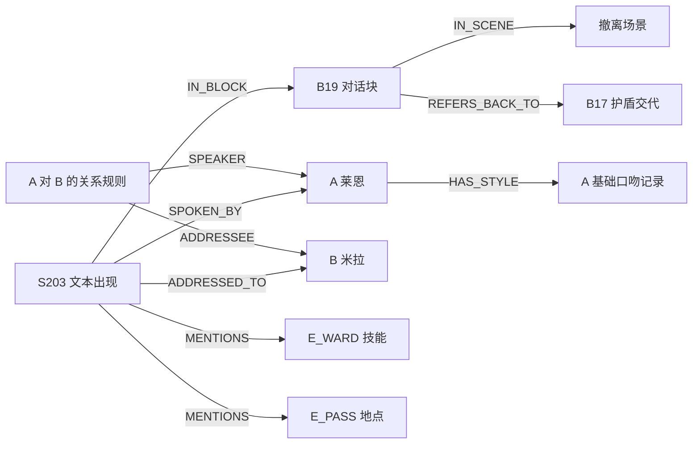

# 游戏本地化 Agent：系统协作与实现细节详解

日期：2026-10-24  
定位：技术设计讲解稿，解释各模块为何这样划分、彼此如何传递数据，以及按什么顺序实现。配套的人员、日程和完整实验安排见 [项目设计与实现 Roadmap](游戏本地化Agent_项目设计与实现Roadmap_2026-10-23.md)。

本文落实当前共识：**LangGraph 执行编排＋DelTA 式翻译记忆＋TransGraph 启发的图引导检索＋有证据的角色 style note＋版本/作用域/依赖驱动的修订。** 7B 提取候选知识，强模型翻译与审校，反馈决定补检索或局部修复；HiAgent 不加入首版；Loong 保留为选择器扩展。

文中台词、角色和运行日志均为构造示例；代码为接口或算法示意，尚未构成可运行实现。论文方法与本项目适配分开说明，示例译文也不是唯一正确译法。

## 1. 先把各设计放在一条数据流里

系统实际要打通三个过程：

```text
建库：游戏脚本/角色资料
      → 可定位的文本记录
      → 场景、对话块、角色与实体
      → 术语、摘要、style note、关系规则及检索索引

翻译：当前文本记录
      → 查询适用规则和相关证据
      → 组成 context pack
      → 翻译 → 检查 → 补证据或修复
      → 保存译文、证据版本和验证结果
      → 形成后续可用的译例记忆

维护：规则/人物表达要求更新
      → 找到旧依赖和可能遗漏的相关文本
      → 判断哪些真的需要改
      → 局部修订与复验
      → 更新依赖、派生记忆和导出状态
```

DelTA 主要回答“翻译时需要哪些类型的记忆”；TransGraph 启发我们回答“当前文本应沿哪些关系找上下文”；LangGraph 回答“证据不足或检查失败后，下一步执行什么”。项目的版本、scope 和依赖机制则保证这些步骤读取的是正确状态，并能维护过去的结果。

**它们通过同一组实体 ID、文本 ID、记忆 ID 和版本号协作。** 不需要让每个模块复制一套术语表和人物档案，也不需要多个 Agent 通过长聊天互相转述事实。

| 设计 | 接收什么 | 产出什么 | 下游怎样使用 |
| --- | --- | --- | --- |
| 7B 知识构建 | 有来源的原文块和角色资料 | 候选实体、关系、note 草稿 | 通过核验后成为可检索记忆 |
| DelTA 式记忆 | 规则、原文、已验证译文 | 不同类型的持久记忆 | 检索器按类型读取 |
| 图引导检索 | occurrence、角色、场景、当前问题 | 相关记忆和源证据 ID | context builder 拉取正文并组织输入 |
| Context Builder | 适用硬规则＋候选证据＋预算 | 带来源和优先级的 context pack | 翻译器和审校器共用 |
| 翻译/审校/修复 | 源文、pack、当前译文或错误 | 译文或结构化问题 | 路由器决定继续、补证据或提交 |
| LangGraph | 当前任务状态和工具观察 | 下一节点与更新后的任务状态 | 管循环、预算、停止和恢复 |
| 版本与依赖 | 实际输入清单、验证、写入请求 | 可追溯译文与反向索引 | 新规则出现时定位复查项 |

## 2. 用同一个游戏片段贯穿全文

### 2.1 源资料

设定一个虚构游戏项目：

- 角色 A：Ryan，中文批准名“莱恩”，军官，表达简洁。
- 角色 B：Mira，中文批准名“米拉”，与 A 一起行动的侦察员。
- 角色 C：Lia，中文批准名“莉娅”，A 的妹妹。
- 技能 E_WARD：Ember Ward，标准译名“余烬护盾”。
- 地点 E_PASS：Mirepass，标准译名“雾口”。

假定开发者资料明确支持“A 对部下言简意赅；对妹妹语气较缓和”。这是示例中 note 的依据；在真实数据里必须找到相应资料，不能凭人物职业套模板。

| occurrence | source | 所在位置 | 说话人→听话人 |
| --- | --- | --- | --- |
| S010 | The Ember Ward protects you from ash. | 教学块 B03 | 教学说明 |
| S101 | Take the Ember Ward. It will hold until dawn. | main 分支、块 B17 | B→A |
| S201 | The bridge is unstable. | main、撤离场景、块 B19 | B→A |
| S202 | We should move now. | main、撤离场景、块 B19 | B→A |
| S203 | Follow me! If the ward fails, don't cross Mirepass. | main、撤离场景、块 B19 | A→B |
| S204 | Follow me! | main、撤离场景、块 B19 | A→B |
| S301 | Follow me! | main、家中场景、块 B25 | A→C |
| S401 | Follow me! | alternate 分支、块 B40 | A→B |
| S_UI1 | Ember Ward | 技能栏按钮 | 无说话人 |

这里有几种不同问题：S203 的 ward 指什么、它的条件和否定怎样保留；S204/S301/S401 虽然文本相同，能否共用口吻；S_UI1 是否允许短译名；规则变更后该修哪些。

### 2.2 把 S203 变成系统任务

```json
{
  "occurrence_id": "S203",
  "source_version": 1,
  "source": "Follow me! If the ward fails, don't cross Mirepass.",
  "scene_id": "scene:evacuation",
  "block_id": "B19",
  "speaker_id": "A",
  "addressee_id": "B",
  "branch_id": "main",
  "phase": "evacuation",
  "story_position": 19,
  "text_type": "dialogue",
  "source_locator": "demo-script:B19:line3",
  "export_key": "dialogue.S203"
}
```

`story_position` 是示例中的分支内顺序，真实项目可以用 scenario_id、事件序号和条件表示。不同分支之间不能直接用一个数字比较先后；元数据不足时保存 unknown。

Agent 首先拿到这个任务对象，再去查证据。它不应只收到一段裸文本后凭常识想象“这可能是军官在打仗”。

## 3. 数据底座：哪些东西是节点，哪些是记忆，哪些只是索引

### 3.1 三层文本对象的实际关系

Scene 保存背景，Dialogue Block 保存局部交流结构，Occurrence 保存具体待翻译记录：

```text
Scene evacuation
  └─ DialogueBlock B19：讨论桥梁风险并撤离
       ├─ S201：The bridge is unstable.
       ├─ S202：We should move now.
       ├─ S203：Follow me! If the ward fails, don't cross Mirepass.
       └─ S204：Follow me!
```

分块先服从脚本条件：换互斥分支必须分开，事件/交流目标明显变化时分开，过长时再按完整轮次拆。4–12 条短台词可以作为开发起点，但不应为了固定数量拆断指代，也不把整场剧情塞进一个块。

翻译仍以 occurrence 为原子记录，block 是其上下文。这样 reviewer 能定位到哪条错、更新能精确修一条、导出也能追踪每条来源。若批量生成一个块，模型必须返回完整 occurrence_id→translation 映射，不能把几条合并成一段无法对应的中文。

### 3.2 角色节点与文本节点不是一一对应



一个角色会关联很多 occurrence；一个 occurrence 也能提及多个实体。style note 用独立记录保存正文、版本和来源，角色节点只是入口。

人物关系适合表示为带条件的记录：`speaker=A, addressee=B, branch=main, phase=evacuation`。不要只存一个永久的 `A FRIEND_OF B`，否则后续剧情的友好关系可能错误指导早期敌对对话。

### 3.3 图与记忆是否需要存两份

不需要。推荐 SQLite 存正文与版本，关系表存可追踪关联，向量表保存可重建的检索表示。

```text
memory_versions：style:A:base@1 的正文、scope、证据、批准状态
relation_edges：A --HAS_STYLE--> style:A:base@1
embeddings：style:A:base@1 对应检索向量及编码器版本
```

三者用同一 ID 相连。全文是事实来源，边负责导航，向量负责补充召回。检索命中向量后还要回库检查有效性，不能让旧向量缓存绕过新版本和 scope。

首版甚至可以不把所有关系都存成通用边：speaker_id、block_id 可直接作为字段，SQL join 就实现了结构关系。可变且需证据的块间关系再放 `relation_edges`。这样保留图查询语义，减少抽象层和维护成本。

### 3.4 最小存储对象及协作边界

| 存储对象 | 主键或关键字段 | 谁写 | 谁读 |
| --- | --- | --- | --- |
| occurrences / blocks / entities | 稳定 ID、source_version、hash、位置和条件 | 导入器；人工核验 | 所有业务节点 |
| memory_versions | record_id＋version、kind、scope、evidence | 规则/note 批准流程；摘要构建器 | 精确查询、检索、翻译与验证 |
| relation_edges | 两端版本、类型、适用条件、证据、状态 | 确定性解析；候选关系批准 | 图扩展、审计 |
| knowledge_snapshot_items | snapshot_id、record_id、选中的 version | 快照创建器 | 所有规则读取 |
| translation_versions | occurrence、revision、正文、run、父版本 | 事务提交器 | TM、评测、导出 |
| context_manifests / dependencies | 输入记录与版本、依赖类型 | context builder 和提交器 | 解释、失效、更新定位 |
| validation_records | 译文 revision、规则快照、检查结果 | QA 与验证提交 | 是否可导出、是否可复用 |
| runs / issues / operations | 任务状态、预算、错误、操作 ID | LangGraph 节点与执行层 | 恢复、计费、分析 |

这是一组逻辑对象，不要求实现复杂 ORM。先用明确 SQL 和少量 repository 函数保证语义正确，再决定是否合表。

## 4. 建库阶段：7B 怎样把源资料变成可用记忆

### 4.1 先用代码确定身份，再让模型做判断

导入器负责 script 已知的场景、位置、分支和 speaker；7B 不重复猜这些字段。提取器主要做：提及识别、别名候选、指代候选、块间关系、角色表达特征。

推荐执行顺序：

```text
解析脚本 → 稳定 ID 与分块 → 已知实体字典
        → 7B 提取当前块中的 mention
        → 基于字典/上下文给 mention 候选实体
        → 对有限候选块做关系核验
        → 输出带证据的草稿
        → 程序校验与必要人工核验
        → 批准记忆与可查询索引
```

例如 ward 可能是技能、普通防护，也可能与某个卫兵名字相似。不能看到词面就合并成 E_WARD。示例中 B17 的明确 Ember Ward、B19 的撤离上下文和人物连续性共同支持该候选；没有足够支持时返回 unresolved。

### 4.2 提取器输入和输出

输入不是“给我建一个知识图谱”，而是有限任务包：

```json
{
  "task": "resolve_reference_and_propose_relation",
  "current_block_id": "B19",
  "current_occurrence_ids": ["S201", "S202", "S203", "S204"],
  "candidate_blocks": ["B17"],
  "known_entities": [
    {"entity_id": "E_WARD", "source_name": "Ember Ward", "type": "skill"}
  ],
  "requirements": ["只使用提供的原文", "给出两端证据", "不确定时返回 unresolved"]
}
```

实际发送时必须把这些 ID 对应的原文和元数据一同展开；只有 ID 没有正文，模型无法判断。

候选输出可以是：

```json
{
  "mention": {
    "occurrence_id": "S203",
    "surface": "ward",
    "candidate_entity_id": "E_WARD",
    "status": "draft",
    "reason_type": "contextual_inference"
  },
  "block_relation": {
    "from_block": "B19",
    "relation": "REFERS_BACK_TO",
    "to_block": "B17",
    "scope": {"branch_id": "main"},
    "evidence": [
      {"occurrence_id": "S203", "quote": "the ward"},
      {"occurrence_id": "S101", "quote": "the Ember Ward"}
    ],
    "status": "draft"
  }
}
```

程序检查 source_version、引用片段确实存在、实体/块 ID 有效、分支兼容；人再判断推断是否成立。`quote` 存在仅证明模型引用了真实片段，不证明其推断正确。影响术语、关系和口吻的候选进入批准库前要核验。

### 4.3 候选边怎样限制，避免 7B 调用失控

块数为 N 时，不让模型比较全部 N² 对。先由代码筛候选：同分支邻近块、共享已知实体的块、同一任务线的前序块；开发阶段每块最多检查少量候选。

首版只保留结构边和少量明确的“指代前文/解释术语/事件承接”。如果一个语义关系不会改变检索结果或评测，暂不抽取。关系方向固定为业务可读语义，例如 **当前块 REFERS_BACK_TO 前文块**，检索时沿出边取证据；不要和论文里其他关系类型的边方向混用。

### 4.4 Style note 的生成过程

对角色 A 先收集一份有 ID 的资料集：开发者 profile、代表性台词，以及各条的分支/阶段。按明确字段提取“观察”，再生成 3–5 句 note：

```text
观察：多次使用简短祈使句；profile 明确对妹妹语气较缓和。
草稿：表达简洁，任务交流偏直接；对妹妹语气缓和。
核验：这些证据是否足以支持稳定特征？是否只在某一场景成立？
批准：稳定部分存 base note，关系差异存 A→C overlay，战斗紧张存场景状态。
```

note 中每个判断最好关联 supporting_evidence_ids。暂时只有一条愤怒台词，就把它记为该场景情绪，不上升为“这个角色一直暴躁”。源资料没有支持的“常用古风语”“喜欢讽刺”等特征不能补写。

使用 [Qwen2.5-7B-Instruct](https://huggingface.co/Qwen/Qwen2.5-7B-Instruct) 作为首个提取候选；同一接口允许更换后端。按 `source_hash + prompt_hash + model_revision` 缓存草稿，修改源文后只重抽相关块。模型返回非法 schema 时有限重试，失败记录下来，不能吞掉异常后当作“没有关系”。

## 5. DelTA 与图检索的具体结合：记忆类型决定内容，关系决定入口

### 5.1 原论文与我们的适配边界

DelTA 的四类记忆为专名记录、双语摘要、短期记忆、长期记忆，并在逐句翻译中读取和更新。其源侧摘要包含已译部分的内容、领域、风格与语调，目标侧摘要概括已译目标内容。[DelTA 论文](https://arxiv.org/html/2410.08143v2)；[作者仓库](https://github.com/YutongWang1216/DocMTAgent)

TransGraph 以语义文本块和块间篇章关系选择相关上下文。[论文](https://aclanthology.org/2026.eacl-long.75/)；[全文](https://aclanthology.org/2026.eacl-long.75.pdf)

下面不是把两个系统先后跑一遍，而是将 DelTA 式记忆作为内容层，将 TransGraph 启发的关系查询作为访问层。我们的异构图、scope、版本和角色 note 均是额外领域设计。

### 5.2 五类记忆怎样通过图访问

| 记忆类型 | 记录示例 | 图/字段入口 | 检索后得到什么 |
| --- | --- | --- | --- |
| 术语 | term:E_WARD:full@1 | S203→MENTIONS→E_WARD→术语记录 | 标准译名、允许简称、适用文本类型 |
| 双语摘要 | summary:B19:source@1；target-summary:runX:B17@1 | 当前块/场景，或相关块→HAS_SUMMARY | 原文进展和本方法已验证译文摘要 |
| STM | runX 中已完成的 S201/S202 | 当前块/兼容前序关系＋完成顺序 | 最近源译对；未译的只能作为原文 |
| LTM | runX 中 B17 的已验证译例 | B19→REFERS_BACK_TO→B17→译例 | 对当前指代和表达有帮助的远处源译对 |
| 角色记忆 | style:A:base@1；relation:A:B@1 | S203→speaker A；addressee B；阶段条件 | 适用基础口吻、关系修正及源台词证据 |

这里的“长期/短期”是读取策略，不一定是两份物理数据库。同一批已验证源译对可放一个 translation store：近邻窗口形成 STM 候选，范围更广的相关查询形成 LTM 候选，最终按 ID 去重。

### 5.3 对 S203 的查询过程，逐步展开

**第一步，读明确身份与当前视图。** 得到 A→B、main、B19、撤离场景；读取当前知识快照 K7 和本方法 runX 的已完成译文水位。此时不能读取其他方法的译文，也不能引用尚未生成的未来目标文本。

**第二步，加载强制规则。** Mirepass 已精确关联 E_PASS，取其批准译名“雾口”。ward 的实体消歧若已核验为 E_WARD，则加载标准名与允许简称；若未核验，标记为待补证据，不能因向量相似度高就升级为硬规则。

**第三步，加载口吻与关系。** 根据 speaker=A 精确取 base note，根据 A→B 与当前 phase 取关系记录。A→C 的家庭关系 note 不适用，即使台词同为 Follow me，也不能混进当前关系规则。

**第四步，拿局部上下文。** 读取 S201/S202。它们若已验证翻译，可作为 STM；若尚未翻译，只提供 source context。当前 B19 的场景摘要说明桥梁不稳、需要撤离，不能从“撤离”自行推出“护盾已经失效”。

**第五步，用图补远距离解释。** B19 的 REFERS_BACK_TO 指向 B17，取 S101 和技能实体说明；这提供 ward 指代候选的证据。B17 没有可用译文也没关系，它的原文仍可作为证据。图关系的价值不依赖目标译文已经存在。

**第六步，向量/词法补漏。** 在有效候选池中搜 ward、Ember Ward、Mirepass 等相关原文。已通过图找到的证据不重复加入；遇到其他分支同名实体时，按条件排除或标 unknown。

**第七步，打包输入。** 将“必须遵守”“角色/关系”“局部原文”“相关原文”“可参考译例”分开；每项保存 record_id、version、source_ids 和选择原因。

这个过程解释了图如何改善记忆访问：有的记录沿角色身份精确获取，有的沿块间关系获取，有的仍由向量补召回。无需把所有数据都向量化之后才有资格被读取。

### 5.4 为什么需要摘要，又为什么不能只用摘要

原文摘要回答“已经发生了什么”；目标摘要回答“本方法已经怎样表达这些内容”；角色 note 回答“谁通常怎样说话”。三者覆盖范围和更新依据不同。

例如 B19 的源侧摘要可为“众人发现桥梁不稳，准备撤离”；它不应替代 S203 的具体条件和否定。审校 If…don't… 时，必须保留原句证据，不能依赖压缩后的摘要判断。

角色 note 也不能塞进不断覆写的全局摘要。否则角色 A 的一次温和表达可能变成全局风格，关系更新后也找不到哪些译文用过旧 note。将 note 独立版本化，才有准确的修订入口。

### 5.5 第一批没有 TM 时怎么办

第一条可以仅用 source-only 场景资料、已批准术语和 note 翻译。译文通过验证后成为该运行自己的 TM。随着处理顺序推进，STM/LTM 才逐步增多。

“有长期记忆模块”不意味着系统开局必须有大量中文译例。开发集 seed TM 可以提供，但所有方法获得同样允许输入，且不使用测试参考答案建立 TM。

### 5.6 一个重要区别：检索发现不等于允许复用

S301 与 S204 source 完全相同，向量可能给出最高相似度。但 A→C 和 A→B 的关系不同，S301 的译文不能直接作为兼容 TM 复制。

可采用两级判断：

```text
相关性：这段资料能否帮助理解？
兼容性：它是否可以作为当前语境下的表达示范，甚至直接复用？
```

跨关系译例通常不作为口吻示范；若其中有可复用的事实，仅抽取相应原文证据并标清用途。首版宁可保守排除存在风格污染风险的目标译例。

## 6. 检索器与 Context Builder 怎样具体实现

### 6.1 将“适用性过滤”和“相关性排序”分开

先判断 record 是否有效、是否属于该运行、是否适用于该语境，再给剩余候选排序。批准术语与匹配的硬规则直接进入 mandatory 集合，不参加可有可无的 top-k 竞争。

scope 使用三值匹配，只比较该规则真正要求的字段。内部先统一规范为“字段→允许值集合”，例如 `speaker_id: {"A"}`；不能把原始字符串直接用于集合判断：

```python
# 算法示意：scope 中未写的字段表示该规则不限制这个字段。
def scope_match(rule_scope, occurrence):
    has_unknown = False
    for field, allowed_values in rule_scope.items():
        value = occurrence.get(field)
        if value is None:
            has_unknown = True
        elif value not in allowed_values:
            return "no_match"
    return "unknown" if has_unknown else "match"
```

基础 A note 只要求 speaker=A，不应因为 addressee 未知就整条丢弃；A→B 称呼规则要求两者都匹配，未知听话人则不能直接套用。条件之间存在明显矛盾时 no_match 优先，不必因另一个字段 unknown 而继续猜测。

剧情有效性单独判断。人物之后变成朋友，不会因数据库版本最新而自动适用于之前。可用开发者批准的全局百科知识与只在特定剧情成立的事实也需分开。

### 6.2 精确查询先于向量查询

以下 SQL 仅示意通过快照加载基础口吻；scope/剧情/冲突检查仍在公共 resolver 中完成：

```sql
SELECT m.*
FROM knowledge_snapshot_items AS s
JOIN memory_versions AS m
  ON m.record_id = s.record_id AND m.version = s.version
WHERE s.snapshot_id = :knowledge_snapshot
  AND m.kind = 'character_style'
  AND m.subject_entity_id = :speaker_id;
```

快照表决定选哪个版本，不能用 `MAX(version)` 随时读最新记录。若旧版本现在被替代，历史快照仍应能读取当时批准的版本；首版可让“纳入某快照”表示该快照中的批准选择，另存当前审批事件，避免全局状态变更破坏历史重放。

### 6.3 图、词法和向量的候选怎样合并

按类型分桶，而不是把所有东西混成一张相似度榜：

```text
mandatory：适用批准术语、硬称呼规则、格式/长度约束
identity_memory：基础 style、关系 note、当前场景
source_evidence：图邻居原文、相关源文片段
examples：兼容且有效的已验证源译对
summaries：相应范围的 source/target 摘要
```

软证据桶中，可对图/词法/向量候选使用排名融合，例如 RRF：`score(r)=Σ 1/(c+rank_i(r))`；c 与 top-k 在开发集确定。没有进入某一路的记录不贡献该路分数。图路径可以作为一条排名信号或类型优先级，但不能越过 scope 条件。

优先保留能够解释当前未知项的直接证据；同一来源已经提供完整句子，就避免再塞一份内容相同的摘要。先按 ID/版本去重，再按文本重复度处理，不能因正文相同就合并不同 scope 的规则。

### 6.4 预算怎样分配

先统计源文、系统指令、mandatory 规则和预留输出，再将剩余额度分配给软证据。辅助上下文约 2,000 tokens、STM 3 对、LTM 3 对、相关块 2 个可以作为起点，而不是三个模块各自占满 2,000 tokens。

mandatory 过大时，优先缩小明确的规则适用范围，或拆批次；仍放不下就返回 budget_conflict。不要裁断规则句子或丢掉占位符要求。证据正文可以选更短完整片段，但必须保留 source ID 和必要前后文。

### 6.5 实际交给模型的 context pack

```json
{
  "pack_id": "pack:runX:S203:1",
  "knowledge_snapshot": "K7",
  "occurrence_id": "S203",
  "hard_constraints": [
    {"ref": "term:E_PASS@1", "source": "Mirepass", "target": "雾口"},
    {"ref": "term:E_WARD@1", "source": "Ember Ward", "target": "余烬护盾", "generic_reference_allowed": "护盾"}
  ],
  "character_style": {
    "ref": "style:A:base@1",
    "text": "表达简洁、直接；不要凭空添加辱骂或夸张语气。"
  },
  "relationship": {
    "ref": "relation:A:B@1",
    "text": "当前撤离任务中 A 对 B 使用简短明确的指示。"
  },
  "scene": {"ref": "summary:B19:source@1", "text": "桥梁不稳，众人准备撤离。"},
  "source_evidence": [
    {"ref": "S101@1", "text": "Take the Ember Ward. It will hold until dawn.", "purpose": "支持 ward 的指代候选"},
    {"ref": "S201@1", "text": "The bridge is unstable.", "purpose": "当前风险背景"}
  ],
  "examples": [],
  "missing_fields": [],
  "context_manifest_ref": "manifest:runX:S203:1"
}
```

这里 style.text 是讲解用的节选；完整库记录按 3–5 句保存。`examples=[]` 是合法状态，不用为了填满模板编造译例。

source_evidence 的角色是解释，不自动成为新规定。若只能支持候选指代而不能确定，missing_fields 仍应保留对应 unresolved 项；不能把示例 pack 的“已核验完成”状态照抄到实际未知任务。

### 6.6 Context Builder 的返回值不应只有一段 prompt

推荐返回 `(pack, manifest, unresolved, conflicts)`：pack 给模型，manifest 给版本依赖和计费，unresolved/conflicts 给路由器。这样检索和后续修订共享结构化结果，而不是事后从 prompt 文本里猜系统用了哪些规则。

manifest 至少保存每个供给项的 ID、版本、内容 hash、角色、图路径/选择原因；检索到了但没发给模型的项另写检索日志。把“找到”与“实际供给”分开，是后面依赖维护能否可信的关键。

## 7. 角色 style note 怎样进入翻译，而不是仅存在数据库里

### 7.1 在请求中组合三层，不反复生成一份新人物档案

```text
当前有效口吻 = 基础 note + 匹配的关系 overlay + 当前场景表达条件
```

这是输入组织方式，不是任意覆盖公式。关系层只修正它声明的维度，场景层不覆盖事实或硬术语。若基础 note 和 overlay 在同一维度冲突且无明确优先级，返回冲突，而不是让 LLM自行挑一个。

例如同为 A 的 Follow me：

| occurrence | 获取的记忆 | 可能的自然表达 |
| --- | --- | --- |
| S204：A→B，撤离 | A 简洁＋任务指示＋紧迫 | 跟上！ |
| S301：A→C，家中 | A 简洁＋对妹妹较缓和＋普通交流 | 跟我来。 |
| S401：alternate | 只使用该分支允许的关系记录 | 取决于该分支证据，不复制 main 的关系结论 |

这里不能规定“跟我来”永远温柔、“跟上”永远粗鲁。它们是语境化候选，真实评价应看原文目的和批准资料。

### 7.2 Prompt 中怎么表达约束

翻译器收到的要求可以固定为：保留意义、条件、否定和格式；遵守 hard_constraints；依据匹配的角色/关系调整句式；不得为了口吻新增身份信息、攻击性或情节；证据不足时明确返回需要确认的字段。

S203 一个可能结果为：

> 跟上！如果护盾失效，就别穿过雾口。

“护盾”作为泛指是否允许，来自术语规则，不由译例习惯决定；don't 必须保留否定。note 可以影响“跟上”的选择，但不能把“如果失效”改成“已经失效”。

### 7.3 Reviewer 怎样检查口吻

Reviewer 同时看到 source、candidate 和同一 pack。反馈需要指出“哪个表达与哪条 note/关系规则冲突”，例如开发者明确规定该角色不使用侮辱性词语，译文却新增辱骂。仅说“听起来不像这个角色”不够。

把反馈分为硬规则违反、证据支持的口吻冲突、可选风格建议、信息不足。只有前两者进入必须修复队列；可选建议不会触发无限改写。没有足够人设证据的项目不强行计算角色风格分。

### 7.4 Note 自身怎样更新

开发者确认修订时新建 style:A:base@2，保存来源和变更维度。例如从“较正式”改为“自然简短”，先找到依赖旧 note 的译文，再看其中哪些真的表达过于正式。只因正文供给过 note，不代表每条译文都需要改。

机器译文出现一处表达问题通常先修译文；只有原始角色资料或批准 brief 有变化，才更新正式 note。审校意见不能自动改写人物设定，避免“译错→形成错误 note→批量传播”的闭环污染。

## 8. 多 LLM 协作：每个角色拿到什么，又交回什么

### 8.1 采用“结构化分工＋按状态激活”

AgentFlow 的 planner/executor/verifier/generator 分离，提供了职责组织参考；其完整方法包含 planner 训练。Puppeteer 研究集中编排器根据状态动态选择 Agent，也包含 RL。[AgentFlow 项目与论文入口](https://agentflow.stanford.edu/)；[Puppeteer 正式论文](https://proceedings.neurips.cc/paper_files/paper/2025/hash/f1320d2e2842169c6fc89dcbd80e94d0-Abstract-Conference.html)

项目只借鉴职责与激活逻辑，落实为以下 Worker，而不是完整接入两套研究框架：

| Worker | 接收 | 返回 | 是否每条在线调用 |
| --- | --- | --- | --- |
| Knowledge Builder，7B | 源文块、profile、候选实体 | 带证据草稿 | 否，建库或源文变更时 |
| Context Worker，程序为主 | occurrence、快照、问题、预算 | pack、manifest、缺失与冲突 | 首次需要；之后按问题定向补取 |
| Coordinator，代码＋必要时 LLM | 当前状态、真实工具观察、允许动作 | 有限动作/查询计划 | 代码常驻；LLM 按需 |
| Translator，强模型 | source＋pack | 译文、待确认项、证据引用 | 无兼容 TM 时 |
| Reviewer，强模型独立调用 | source＋当前译文＋pack＋QA 结果 | pass/issues/insufficient_context | 首版每次生成和修复后 |
| Repairer，强模型 | 当前译文、确认问题、同一或扩展 pack | 候选修订和修改说明 | 有问题才调用 |
| QA / Committer，程序 | 内容、规则、expected versions | 检查结果或提交回执 | 每条输出必须经过 |

强模型可以共享一个后端，但调用职责分开。7B 不需要先翻译一遍再让强模型重译；它优先承担可缓存的知识构建。因此当前架构可称大小模型分工，是否节省端到端时间仍需要测量。

### 8.2 交接的是带依据的任务包

上下文问题可以表达为：

```json
{
  "run_id": "runX",
  "occurrence_id": "S203",
  "knowledge_snapshot": "K7",
  "action": "retrieve_context",
  "query": {
    "purpose": "resolve_reference",
    "mention": "ward",
    "source_occurrence_id": "S203",
    "candidate_entity_ids": ["E_WARD"],
    "branch_id": "main"
  },
  "remaining_extra_retrievals": 1
}
```

实际检索工具校验字段与权限，然后返回真实查询结果。Coordinator 不能自己写一句“已查到 E_WARD”，便算完成检索。Worker 返回的证据 ID 必须属于该运行允许读取的资料，不能直接引用未知记录。

### 8.3 哪些决策交给模型，哪些由代码决定

程序处理明确判断：字段是否存在、规则是否匹配、占位符是否相同、是否还有预算、是否 locked、能否提交。

模型处理语义判断：ward 是否仍有歧义、某一语境是否需要补角色关系、当前表达是否确实违背 note、修订能否保留原意。模型只能从已允许的动作中选下一步；参数不合法或动作不适用时由执行层拒绝。

即使 LangGraph 的节点和边预先定义，也可以形成 Agent：每个状态下选择哪个证据、是否补检索、是否修订、何时承认不确定，仍由观察驱动。它不要求模型自由调用任意工具，更不要求为每个数据库查询创建一个“自主 Agent”。

### 8.4 并行发生在哪里

同一读取视图下，术语、基础 note、关系规则可以并行查；独立场景也可以并发。必须先 resolve 出当前任务的读取视图，并对总预算统一计数。

同场景翻译若要利用刚生成的 STM，就按顺序提交；否则下一条可能读不到上一条，实验行为也会随线程调度变化。review 必须等生成，repair 必须等反馈，这些依赖不能用“多 Agent”消除。

7B 离线提取可提前完成，避免放在每条在线翻译的关键路径。实验分别报告离线建库时间和在线延迟，而不是把建库完全隐藏后宣称系统更快。

## 9. LangGraph 的具体落地：状态、节点与路由

LangGraph 的 StateGraph 通过 state、node 和 edge 组织有状态工作流，条件边可以按当前状态选择节点。[官方 Graph API](https://docs.langchain.com/oss/python/langgraph/graph-api)

### 9.1 State 存哪些内容

```python
# 接口示意；为便于阅读省略更严格的 Literal / Pydantic 定义。
from typing import TypedDict

class TranslationState(TypedDict):
    run_id: str
    occurrence_id: str
    source_version: int
    knowledge_snapshot: str
    memory_read_watermark: int
    expected_translation_revision: int | None
    context_pack_ref: str | None
    candidate_text: str | None
    candidate_hash: str | None
    issues: list[dict]
    unresolved_fields: list[str]
    hard_qa_passed: bool
    semantic_review_passed: bool
    extra_retrievals_used: int
    repairs_used: int
    model_requests_used: int
    status: str
```

state 放当前候选和控制字段；完整工具返回、全部历史候选、token 账单留在外部 run log，state 用 ID 引用。不需要维护一条不断增长的聊天消息列表，也无需 HiAgent 摘要压缩。

`issues` 表示当前候选尚未解决的问题，每轮替换，不无条件 append；旧问题保存在历史日志。新 candidate 或新 pack 产生后，旧的 QA/review 标志失效，必须重新检查。否则系统可能把上一版的 pass 错配到下一版译文。

检查结果应绑定 `candidate_hash + context_pack_hash + validator_version`。Coordinator 不能仅看到 `semantic_review_passed=True` 就提交一个后来已改过的 candidate。

### 9.2 节点怎样拆

建议节点：`load_task`、`build_context`、`assess_context`、`generate_or_reuse`、`hard_qa`、`semantic_review`、`decide_next`、`retrieve_more`、`repair`、`commit`、`stop`。

`build_context` 是程序服务；`assess_context` 可先查 unresolved，再在确有歧义时调用模型。`decide_next` 汇总检查结果和预算，避免每个 Worker 各自决定“我再调用一个模型”。

```python
# 图连接示意：业务函数需要另行实现、注入和测试。
from langgraph.graph import StateGraph, START, END

graph = StateGraph(TranslationState)
for name, fn in node_functions.items():
    graph.add_node(name, fn)

graph.add_edge(START, "load_task")
graph.add_edge("load_task", "build_context")
graph.add_edge("build_context", "assess_context")
graph.add_edge("assess_context", "decide_next")
graph.add_edge("generate_or_reuse", "hard_qa")
graph.add_edge("hard_qa", "decide_next")
graph.add_edge("semantic_review", "decide_next")
graph.add_edge("retrieve_more", "assess_context")
graph.add_edge("repair", "hard_qa")

graph.add_conditional_edges("decide_next", route, {
    "generate": "generate_or_reuse",
    "qa": "hard_qa",
    "review": "semantic_review",
    "retrieve": "retrieve_more",
    "repair": "repair",
    "commit": "commit",
    "stop": "stop",
})
graph.add_edge("commit", END)
graph.add_edge("stop", END)
# 编译时注入磁盘持久化 checkpointer；此处不创建内存版冒充可恢复运行。
```

`retrieve_more` 必须物化扩展后的新 pack，并使受其影响的语义验证失效。如果它改变了硬规则解析，也应重新运行 hard_qa；这些脏标志由公共状态更新函数维护，不能要求每个节点靠约定记住。

### 9.3 路由优先级

| 当前状态 | 下一步 | 原因 |
| --- | --- | --- |
| 有冲突且无法补取；或预算耗尽 | stop，标 needs_input/failed | 不以继续改写掩盖缺失 |
| 缺少必要证据，仍有检索预算 | retrieve | 先解决依据问题 |
| 尚无候选且证据充分 | generate/reuse | 进入生成 |
| 有候选，但新 pack 使其 hard QA 失效 | qa | 针对当前候选和规则重新检查 |
| 当前候选存在硬违规 | repair 或 stop | 格式不完整时不消耗语义审校 |
| hard QA 通过，但当前候选/pack 尚未审校 | review | 完成语义和角色检查 |
| reviewer 指出缺证据 | retrieve 或 needs_input | 不能直接把不确定当成错误 |
| 有确认错误，且有修复预算 | repair | 只处理具体问题 |
| 当前候选和当前 pack 全部验证通过 | commit | 进入程序提交门控 |
| 仅有非强制风格建议 | commit，保留建议 | 允许不改 |

路由器每次转移先看总模型预算，再看检索/修复预算。首版建议最多 2 次额外检索、2 轮修复、10 次模型请求，错误重试也计数。增加 LangGraph recursion limit 不是增加业务预算；图层步数限制只是最后防线。

## 10. 翻译、错误反馈、补检索和修复怎样闭环

### 10.1 正常的一次运行

以 S203 为例：load→检索术语和 note→取得 B17 指代证据→生成“跟上！如果护盾失效，就别穿过雾口。”→hard QA→semantic review→提交。

Translator 和 Reviewer 均收到同一 pack；Reviewer 额外收到当前译文和 QA 结果。假如无额外查询，两次强模型调用即可完成生成与审校；离线建库、可选摘要更新另计。

### 10.2 三类错误导致三种路径

**情况 A：译文遗漏否定。** 初稿为“跟上！如果护盾失效，就穿过雾口。”语义 reviewer 指出 don't 的否定缺失，证据已经在源文，直接修复即可；无需查整个角色图。

**情况 B：ward 被译成“卫兵”。** 如果当前 pack 已给出核验过的技能指代和证据，可按错误修复；如果 pack 没有充分消歧，先触发 targeted retrieval，取得 B17 和实体说明，再决定是否修订。缺证据和模型未遵守已有证据是不同故障。

**情况 C：听话人未知，口吻可能不适用。** 先查脚本或同一对话条件；不能从 A 的所有关系里选相似度最高的 B。仍未知且称呼依赖身份时返回 needs_input；若该句不需要关系信息且基础 note 足够，可以明确记录降级条件后继续，而不是一律拒绝所有缺字段文本。

### 10.3 反馈为什么采用 LLMRefine 式问题结构

[translation-agent](https://github.com/andrewyng/translation-agent) 提供翻译→反思→改进流程，适合做最小反思基线。[LLMRefine](https://aclanthology.org/2024.findings-naacl.92/) 使用学习到的细粒度反馈和模拟退火搜索；本项目仅借鉴可定位、可执行的反馈，采用有限轮修复，不声称复现其训练与搜索。

S203 的否定错误可以表达为：

```json
{
  "candidate_ref": "candidate:runX:S203:1",
  "issue_id": "issue:negation:1",
  "type": "meaning_negation",
  "severity": "critical",
  "target_quote": "就穿过雾口",
  "source_quote": "don't cross Mirepass",
  "evidence_ids": ["S203@1"],
  "requires_more_context": false,
  "instruction": "恢复否定，不改动条件句和地点译名",
  "status": "supported"
}
```

反馈必须绑定具体 candidate；修复后重新定位问题，不能把旧字符 offset 直接套到新字符串。给出 quote 时检查它确实存在；给出规则引用时检查该规则在当前 pack 中且 scope 匹配。确认文本片段存在也不能代替判断反馈的语义是否正确。

### 10.4 Repairer 接收什么，避免把“局部修复”做成全段重译

Repairer 输入为 source、当前 target、同一/扩展 pack、确认问题列表和保护要求。让模型返回完整候选译文及简短 edits，而不是直接操作数据库。

“最小”优先表示不改变无关语义、术语、占位符和既有正确表达。diff/edit distance 只能辅助检查，不能用“字符改得少”掩盖错误残留。对于否定例子，预期主要差异是增加“别”；如果模型顺便改了角色语气和地点，需说明或拒绝不必要改动。

所有修复重新经过硬 QA 和语义审校。若解决一个问题却新增另一个，不能仅因为 issue:negation 消失就提交。检测候选 hash 重复和问题来回震荡，超过预算停下并保留最后可用状态。

### 10.5 反馈会写入哪种记忆

| 反馈 | 立即影响 | 是否改变正式项目规则 |
| --- | --- | --- |
| 当前译文漏否定 | 当前 repair 队列、run log | 否 |
| reviewer 认为 note 与原资料冲突 | note 草稿待核验、当前任务必要时挂起 | 不自动改变 |
| 开发者确认新称呼/术语 | 新规则版本与更新事件 | 是，经批准后 |
| 多次出现“缩短 UI 时漏掉费用” | 可选经验记录 | 与正式事实分开，首版不做自动在线自学习 |

这避免把每条审校建议都写成规则，再让后续译文无条件服从。首版只需要当前问题清单和完整日志，不必新增另一个经验 Agent。

## 11. 翻译通过后，怎样安全写回 DelTA 式记忆

### 11.1 一次提交包含什么

提交器同时保存：译文版本、生成 pack manifest、QA/review 记录、依赖和提交回执。使用一个短数据库事务，不能先公开译文再过几秒补依赖。

验证通过的输出可以进入机器验证 TM；人工批准另有标记。草稿和失败输出可留历史，但不进入默认检索池。这样“上一句翻译错误”不会未经检查立即成为下一句示范。

### 11.2 四类记忆如何更新

| 记忆 | 提交后动作 | 为什么这样做 |
| --- | --- | --- |
| STM | 新增当前源译对；读取时取兼容近邻 | 下一条能使用刚完成的表达 |
| LTM | 同一源译对纳入较广范围候选；可异步建向量 | 不必复制一份实体内容 |
| 术语 | 只提出新术语候选，不覆盖批准名 | 首次译法不应天然变成永久规则 |
| 双语摘要 | 达到块边界/指定批次时构建或更新 | 避免每条短文本额外调用摘要模型 |
| 角色 note | 通常不更新；资料/brief 改变时另走批准 | 保持人设依据稳定 |

STM 一经事务提交即可读；LTM 向量尚未就绪时用结构/词法回退，不把向量索引当正文提交前置条件。摘要是可重建派生物，更新失败不能让有效译文丢失，但也不能把旧摘要标成最新。

### 11.3 双语摘要怎么生成，避免互相污染

首版在对话块完成后生成块级 source summary 和 target summary，需要场景概览时再组合相关块。source summary 只读源文；target summary 只读本方法已验证输出，并保存覆盖的 occurrence 和 revision。

摘要生成器必须说明“不添加推断、保留条件适用范围、不把尚未发生的情况说成事实”。对数值、否定和指代的严格判断仍读源句。摘要存输入 ID、hash、生成模型与 prompt 版本，后续可以判断是否需要重建。

用一个模型请求返回分开的 source/target 摘要虽可节省调用，但会增加相互混用风险；首版若采用，应明确按不同输入字段生成并人工抽查。与 DelTA 基线对比时记录该适配，不把块级更新说成原方法参数完全一致。

### 11.4 两种版本坐标：知识快照与在线译文水位

知识快照 K7 固定批准术语、note、源文版本与关系选择；在线译文会随着 runX 逐条完成而增长。不能把“固定快照”理解为整个运行期间禁止出现任何新 STM。

推荐一个简化读取视图：

```text
ReadView = (knowledge_snapshot=K7,
            experiment_branch=runX,
            committed_translation_watermark=18)
```

处理 S203 时只取该运行中 commit_seq≤18 且兼容的译例，提交后 seq 增加，下一条获取新视图。同一条任务内所有检索使用固定视图；补检索不意外读入其他线程刚写的译例，若确需刷新则显式建新 pack 并重新验证。

小规模可用一个 commit_seq 字段实现，不要求完整通用 MVCC 系统。实验分支也不等同于剧情 branch：前者隔离方法输出，后者表示故事条件，两者都要检查。

### 11.5 同一 PO key 的不同 occurrence 怎样收口

内部保存各 occurrence 的译文，导出器按 export_key 分组；组内所有有效译文相同才直接输出。不同则标 export_conflict，给出每个出现位置和语境差异。

即使 S204 和 S301 各自译得正确，若游戏只给了一个相同 msgid 且无 msgctxt 的 PO key，也无法无损输出两个版本。首版可保留 JSONL 全结果与冲突清单；需要改脚本 key 时另提补丁方案，不静默选其中一个覆盖。

## 12. 版本与依赖：怎样从“翻译记忆”走到“可维护项目”

### 12.1 生成依赖不是模型脑内因果

系统能确定实际发给模型什么、哪些规则在程序中判为适用，以及哪些证据被模型引用；无法可靠知道模型究竟受每个 token 影响多少。

因此依赖采用保守记录：

```text
translation:S203@1
  → applicable_constraint → term:E_PASS@1
  → supplied_context → style:A:base@1
  → supplied_context → relation:A:B@1
  → supplied_context → summary:B19:source@1
  → supplied_context → source:S101@1
  → cited_support → source:S101@1
```

所有供给项都在 manifest 中；`cited_support` 只是附加解释。检索到了但未进入 pack 的条目记 retrieved_only，不默认算译文依赖。

派生物也有依赖，例如 `target-summary:B19@1 → translation:S203@1`。图扩展边另存路径与版本，若它影响实体消歧，应保存对应 resolver 结果的来源，不能只记最后的术语名而遗失判断依据。

### 12.2 一个更新事件怎样从图上找到候选

旧记录 → 反向查谁依赖它 → 再查谁依赖这些派生物，直到得到译文候选。闭包使用 `(object_type, object_id, version)` 去重，防循环并限制访问规模。

但闭包只能看到已有依赖。新增规则、历史漏记、提取遗漏都可能没有边，因此还要根据作用域、实体别名、源/目标词面和向量检索补漏。

```text
C_dependency = reverse_dependencies(changed_old_versions)
C_scope      = query_occurrences(old_scope UNION new_scope)
C_retrieval  = search_changed_entities_and_rule_content(...)
C            = C_dependency UNION C_scope UNION C_retrieval
```

scope 查询可以先以 scene/type/role 等索引缩小范围，但不能只看新 scope；规则退出旧范围也可能需要恢复通用表达。更新实验中，U1 应享有同样的 scope 和检索能力，U2 仅增加版本依赖，才能判断依赖索引的实际价值。

### 12.3 贯穿例子：新增 UI 短名规则

旧知识 K7 规定 Ember Ward 的全名“余烬护盾”，此前技能按钮 S_UI1 也使用全名。现在开发者批准一条新规则：**仅技能栏按钮可显示“烬盾”，对话和说明保持全名或原批准泛指。**

新记录可为 `term:E_WARD:ui_short@1`，scope 明确为 entity=E_WARD、text_type=ui、control_type=skill_button。规则同时声明它在 UI 展示名这一维度覆盖通用全名；没有这种明确覆盖关系时不能靠“更具体”自行压掉硬规则。

这个新 record 没有旧依赖边，所以必须用 scope/实体查询找 S_UI1。反向依赖仍可帮助查出曾使用相关全名记录的项目，但不能单靠它保证新增规则覆盖率。

| 记录 | 复查依据 | 是否需要改 |
| --- | --- | --- |
| S_UI1：Ember Ward，技能按钮 | 匹配新 UI 规则；旧文为“余烬护盾” | 改为“烬盾” |
| S101：Take the Ember Ward…，对话 | 实体相同；可能被补漏检索命中 | 不改，仍用全名 |
| S203：the ward，已译“护盾” | 可能有间接实体依赖 | 不因 UI 短名改动；泛指仍合法 |
| 另一实体也叫 Ember Ward | 同形词召回 | 若实体不同则不适用 |
| 同技能的介绍段落 | 同实体，不是技能按钮 | 不改 |
| locked 的技能按钮 | 匹配新规则，但受锁定保护 | proposed diff，不自动提交 |

这个例子说明：候选集合可以保守偏大，最终修改集合必须由新规则下的实际违规决定。不能把每个候选都强制重新生成一遍。

### 12.4 复查后的三个结果

| 结果 | 写入什么 | 保护什么 |
| --- | --- | --- |
| no_change | 当前正文的 K8 验证记录与复查证据 | 原字节和生成历史 |
| needs_change 且允许提交 | 新译文 revision、diff、验证、依赖 | 父版本、可回滚记录 |
| needs_change 但 locked/缺证据/超预算 | proposed diff 或未解决原因 | 不伪称已满足新规则 |

新规则生效前先登记需要失效/复查的状态，再允许新快照用于导出；不能先发布 K8、仍把全部旧文标绿，随后才慢慢找影响项。首版可把更新任务设为 staged，完成必要验证后发布新导出快照；未完成项明确阻塞或标注 partial。

### 12.5 不改字也需要新验证，但不能抹掉生成来源

S101 在 K8 下仍正确。保留 `translation:S101@1` 的原始生成 provenance：它当初在 K7 下，读取了哪些术语和译例。另建 `validation:S101@1:K8` 表示当前正文已根据 K8 复查通过。

若把旧依赖直接改成 K8，再说它“原本就是按 K8 生成”，审计就失真；若完全不记录新验证，系统又会永远把它当成 stale。

因此区分：

```text
generation_provenance：这个正文当初如何产生，永久保留。
current_validation：这个正文现在是否满足目标规则视图，可新增。
serving_eligibility：能否作为当前 TM/导出项，由当前验证和源版本决定。
```

失效处理也分原因：原始输入曾变更，不必永久否定所有历史正文；正文经当前规则重新验证可恢复使用资格。但其他派生物如果实际含有旧错误内容，仍需重建，不能仅给译文打一个 pass 就让所有旧摘要一起恢复。

### 12.6 通过摘要和 TM 的间接依赖怎么处理

假设旧 target summary 写了“技能按钮统一显示余烬护盾”，它在 UI 新规则下会误导后续生成。必须先将它置 stale，并在生成修订 pack 时排除；重建后才重新纳入。失效不能等到整批修订完成后才做，否则新译文可能继续读取旧摘要。

源侧剧情摘要未使用目标译名，通常无需因中文短名更新重新生成。是否重建由实际内容和依赖类型决定，而非“一次更新全部摘要重算”。

若 T2 曾把 T1 当 TM，T1 改了不代表 T2 必须跟着改；T2 进入复查后仍可 no_change。新摘要/新 TM 不可读取自己尚未通过的修订候选，避免形成循环自证。

## 13. 提交、恢复与缓存怎样配合

### 13.1 提交前的最后门控

提交请求包括 operation_id、occurrence_id、expected_source_version、expected_target_revision、knowledge_snapshot、candidate_hash、pack_hash 和验证记录。

事务中先确认：source 未变、当前 target revision 符合预期、锁定状态未变、该候选在该 pack 下通过验证、任务快照仍可提交。任何条件不符都返回 stale/conflict，由上层决定重跑，不做 last-write-wins。

若该 operation_id 已成功，返回原回执，不重复写入。这保证本地提交幂等；外部模型请求若超时后重试，可能重复计费，日志应如实记录，不能承诺外部请求绝不重复执行。

### 13.2 checkpoint 恢复不等于重新执行所有节点

LangGraph checkpoint 记录运行状态，业务表保存已经完成的提交。恢复时查操作回执，避免“提交成功但 checkpoint 尚未写入”导致再次提交。磁盘持久化和业务事务需要明确责任边界。[LangGraph 持久化说明](https://docs.langchain.com/oss/python/langgraph/persistence)

首版可只支持节点边界恢复。长模型调用中断后，先查请求/候选缓存，有可信结果才复用；没有结果就按预算重试。不要把内存状态能续跑当成进程重启恢复已经完成。

### 13.3 缓存键必须包含语境

```text
提取缓存：source_hash + candidate_context_hash + extractor/prompt revision
检索缓存：occurrence/source version + K + read watermark + query + retriever config
生成缓存：source + pack hash + model revision + generation config + role prompt hash
验证缓存：candidate hash + pack hash + validator/prompt version
```

只用英文原文当生成缓存键，会让 S204/S301 的口吻串用。只用 entity_id 缓存术语，又会忽略 UI short/full 及版本。模型服务不能固定底层版本时，记录返回标识与运行日期，并说明重放局限。

### 13.4 哪里需要日志，哪里不需要长篇推理

记录实际工具参数、返回摘要与外置结果 ID、选择的证据、下一动作、问题和验证结果即可。decision_reason 可写“ward 未消歧，查前序同实体块”；不要求保存模型私有推理过程。

日志应能回答：为什么找到 B17、为什么排除 alternate 分支、为什么没有改 S101、为什么锁定项仅给 diff、每一步花了多少时间与 token。

## 14. 代码按什么接口衔接，以及怎样逐步实现

### 14.1 先固定六个跨模块接口

```text
# 这些是接口签名示意，不是 Python 实现。
ingest(source_bundle) -> DatasetManifest
extract(block_ids, source_view, model_config) -> CandidateKnowledge
resolve_memory(occurrence_id, read_view, question=None) -> ContextResult
translate_one(task, read_view, limits) -> TranslationOutcome
apply_update(event, base_project_view) -> UpdateReport
export_project(project_view, format) -> ExportResult
```

`ContextResult` 含 pack、manifest、unresolved/conflicts；`TranslationOutcome` 必须区分 committed、needs_input、failed、proposed_diff；`UpdateReport` 含候选发现、no_change、实际修改、锁定建议、失败与成本。不要用一个字符串/空值承载所有状态。

模块可先用人工知识和假模型后端集成。mock 仅验证控制流与持久化，不作为翻译性能结果。接口稳定后替换 7B/强模型，不要求数据、Agent、评测三组等待同一个 API 接通。

### 14.2 第一步：先做 8–20 条可解释样例

实现 occurrence、block、entity 和基本 memory schema；手工录入 S203 这样的术语、角色关系与源证据。写一个纯程序 `build_context()`，打印记录 ID、适用结果和排除原因。

**验收：**A→B 查询不返回 A→C 的关系规则；新旧版本能分别重放；unknown 不被当成 match。同一英文不同出现位置仍保留不同 occurrence 和 export_key 映射。

此时先不做 7B 自动抽取。先验证正确知识能否被正确使用，才有办法诊断后续错误来自提取还是检索。

### 14.3 第二步：打通一次生成与一次验证

强模型读取 source＋pack，程序做格式/术语 QA，再调用独立 reviewer。通过后事务写入 target、manifest、validation 和依赖，下一条能以该结果作为兼容 STM。

**验收：**S203 的条件/否定保留；没有译例时可运行；草稿不入 TM；不同方法的译文不会互相读取。此阶段即得到最小端到端系统。

### 14.4 第三步：加图路径与7B候选，不改变接口

先加入确定性 speaker/block/scene 关系和手工核验的 B19→B17；再让 7B 对有限候选提出边与 note。两者都落到同一关系和记忆 schema。

**验收：**能解释图路径带来了哪条原文证据；删掉该边后检索仍能通过词法/向量补漏，或明确显示缺失。7B 输出错误关系时进入草稿/拒绝，不悄悄成为批准事实。

### 14.5 第四步：加 LangGraph 决策与修复循环

把已有函数包装为节点，增加 budget manager、候选 hash、问题列表和有限转移。先写明确路由，再在歧义判断处接模型，不必一开始训练协调器。

**验收：**否定遗漏直接修；指代不明先补检索；无依据时 needs_input；两轮后仍失败能停止；修复后不沿用旧的 pass。通过故障样例验证回路，而不只演示第一遍就成功的文本。

### 14.6 第五步：实现一条规则变更的完整维护

先做 UI 短名事件：产生 K8→依赖/范围/检索候选→复查→no_change 或修订→复验→提交/锁定建议→导出。然后扩到术语改名、关系称呼、长度变更。

**验收：**新规则没有旧依赖时也能找到按钮；同实体对话不被改；same-surface 不同实体不被误改；scope 缩小/撤销也能重查旧范围；no_change 保留原字节和旧 provenance。

### 14.7 第六步：补真实数据、基线、恢复与评测

替换示例为固定版本游戏数据，执行 source/reference 隔离、分组 split、固定旧项目、事件 gold、静态盲评。接入 DelTA 与 reflection adapter，并从干净环境重放。

**验收：**同一任务中断恢复不重复提交；过期任务不能覆盖新版本；PO 冲突显式报告；基线读取同样批准资料；结果包含失败、重试和建库成本。

这六步是依赖顺序，不是额外六个大工程。与原 20 天计划对应：前两步 D1–D6，第三/四步与其并行并在 D8 左右集成，第五步最晚 D10 闭环，D11–D12 冻结，第六步的正式评测与报告放在后半程。不要等自动图谱完美后才尝试第一条翻译。

## 15. 如何验证“这些设计协作有效”

### 15.1 检索层验证

为开发样例标必需证据，例如 S203 的地点名、角色 note、ward 指代证据。评估适用证据覆盖、错误分支混入、无关目标译例混入与 tokens，而不只看最终中文是否好听。

比较“同样知识的固定精确/词法/向量检索”与“加图路径”。如果前者已能拿全证据，图可能只增加维护成本；这是应报告的结果。图边存在并不证明它有用，必须看它改变了什么输入与错误。

### 15.2 生成与反馈层验证

固定 source 和 pack，比较直接生成、translation-agent 式一轮反思、结构化一轮反馈。预算一致时才能分析反馈形式；完整系统允许两轮时另外报告调用开销。

诊断样例应包含遗漏否定、错实体、错误称呼、格式破坏、原本正确但 reviewer 想改等情况。检查“修了多少真错误”及“引入多少新错误”，而不是只统计生成了几条反馈。

### 15.3 记忆与角色层验证

对相同资料比较有/无显式 style note，保留源 profile 以区分组织作用与信息增量。人工盲评者同时看源文和批准 brief，分别评语义、语境、自然度和口吻，不能用本系统 reviewer 的 pass 充当最终质量答案。

### 15.4 更新层验证

使用已有 roadmap 的 12 个独立测试事件，每个作用在同一 40 条旧项目；全项目标注 R_gold、A_gold、U_gold。比较强检索 U1、依赖＋同样检索 U2、全量复查 U3；可再加仅依赖消融。

关键指标是应复查项召回、真正需改项修复率、无需修改项的改动/回归、锁定覆盖和总成本。no_change 不是失败；“被检索到”也不等于“应该被改”。事件宏平均，真实和构造样例分开报告。

### 15.5 工程层必须覆盖的协作故障

| 故障 | 预期表现 |
| --- | --- |
| 7B 提取不存在的证据片段 | 草稿校验失败，不入批准库 |
| 高相似度结果来自错误分支 | scope 排除，不进入 pack |
| mandatory 太长 | 明确 budget_conflict，不静默丢规则 |
| repair 后沿用旧 QA pass | hash 绑定阻止提交，重新验证 |
| 新 UI 规则无旧依赖 | scope/实体查询补漏找到目标 |
| 新规则发布前派生摘要已过期 | 置 stale，不参与修订输入 |
| 任务执行中被别人更新 target | expected_revision 检查返回冲突 |
| 提交成功后进程退出、随后恢复 | operation_id 返回原回执，不重写 |
| 相同 PO key 下存在不同有效译文 | export_conflict，不静默覆盖 |

优先测试这些业务边界，不为每个简单包装函数写只复述实现的测试。最终仍需真实 end-to-end 运行，因为模块单测无法证明模型判断可靠。

## 16. Loong 扩展究竟接在哪里

扩展点在第 6 节“软证据选择”，即召回候选之后、context pack 物化之前：

```text
精确硬规则 ───────────────────────────┐
图/词法/向量候选 → ContextSelector → 选中软证据 ├→ pack
角色身份与必需关系规则 ────────────────┘
```

[Loong](https://arxiv.org/html/2605.30274v1) 的方法涉及摘要、译例、实体信息的选择及 SFT/DPO 优化；本项目可借鉴“选择有用上下文”，之后才考虑训练。首版可先用固定 top-k 和提示式选择器比较。

训练输出应为 `selected_evidence_ids / ranking / request_more`，动作掩码阻止它删除批准硬约束。记录候选列表、选择、下游质量和成本，形成后续训练数据；日志齐全不等于训练数据已经足够。

用户提出的“依赖程度排序剪枝”，这里解释为候选上下文对当前任务的效用排序。已经发生的版本依赖仍是历史记录，不能让选择器为了省 tokens 擦掉；否则更新定位和审计都会失真。

当前 20 天首版不依赖 RL。以后做 SFT/DPO 要独立训练与验证资料，不能在测试事件上找最优证据再报作未见测试。另做在线 RL 时还需要可重置环境与可信奖励，不能把 Loong 的 DPO 直接写成已完成 Agentic RL。

## 17. 每个模块完成后，你应该能解释什么

| 模块 | 可展示的具体结果 |
| --- | --- |
| 数据与分块 | 当前台词在哪、谁说给谁、为什么属于这个块、如何导出 |
| 7B 建库 | 哪个事实来自哪句原文、为何批准、哪些候选不确定 |
| DelTA 式记忆 | 当前用到哪些术语/摘要/近远译例，第一条无 TM 时怎样处理 |
| 图检索 | 沿什么路径拿到哪条证据，为什么没有用相似但不适用的资料 |
| Style note | 基础口吻、关系修正、场景条件分别如何影响表达 |
| 多模型与执行图 | 为什么调用这个 Worker、为什么补查、何时停止 |
| 反馈修复 | 错在哪里、凭什么改、改后如何证明没有新增问题 |
| 版本依赖与维护 | 为什么复查这些、为什么只改其中一部分、哪些仍被保护 |
| 写回与恢复 | 新译文何时进入 TM、旧摘要何时失效、失败后如何继续 |

可以这样描述最终系统：**它根据当前文本身份和规则版本，组合适用的项目记忆；用工具观察和错误反馈决定下一动作；再把经过验证的结果及其依据保存下来，使后续翻译和规则更新能够接着工作。** 实现工作的核心是把这些交接条件做准确，并用同样输入和预算的对照检验效果。

## 18. 配套阅读与代码入口

| 阅读目的 | 论文/文档 | 可复用入口 |
| --- | --- | --- |
| 多层翻译记忆及原始基线 | [DelTA](https://arxiv.org/html/2410.08143v2) | [DocMTAgent](https://github.com/YutongWang1216/DocMTAgent) |
| 块间关系引导上下文 | [TransGraph](https://aclanthology.org/2026.eacl-long.75/) | 按论文实现本项目关系检索，不预设已有可运行官方仓库 |
| 图执行和条件转移 | [LangGraph Graph API](https://docs.langchain.com/oss/python/langgraph/graph-api) | [LangGraph](https://github.com/langchain-ai/langgraph) |
| 职责分离 | [AgentFlow](https://agentflow.stanford.edu/) | [作者代码](https://github.com/lupantech/AgentFlow) |
| 动态激活 | [Puppeteer](https://proceedings.neurips.cc/paper_files/paper/2025/hash/f1320d2e2842169c6fc89dcbd80e94d0-Abstract-Conference.html) | [作者分支](https://github.com/OpenBMB/ChatDev/tree/puppeteer) |
| 最小反思改进基线 | [translation-agent 说明](https://github.com/andrewyng/translation-agent) | 同仓库的翻译/反思/改进函数 |
| 可执行错误反馈 | [LLMRefine](https://aclanthology.org/2024.findings-naacl.92/) | 首版实现问题 schema 与有限修复，明确是方法启发 |
| 可训练上下文选择扩展 | [Loong](https://arxiv.org/html/2605.30274v1) | [LoongDocMT](https://github.com/YutongWang1216/LoongDocMT)，采用前核对实现状态 |

本文重在协作机制与实现顺序；样本数量、人员工时、正式实验配置和降级方案以 [配套 Roadmap](游戏本地化Agent_项目设计与实现Roadmap_2026-10-23.md) 为主。外部仓库尚未在本工作区运行验证，接入时固定版本并记录适配差异。
