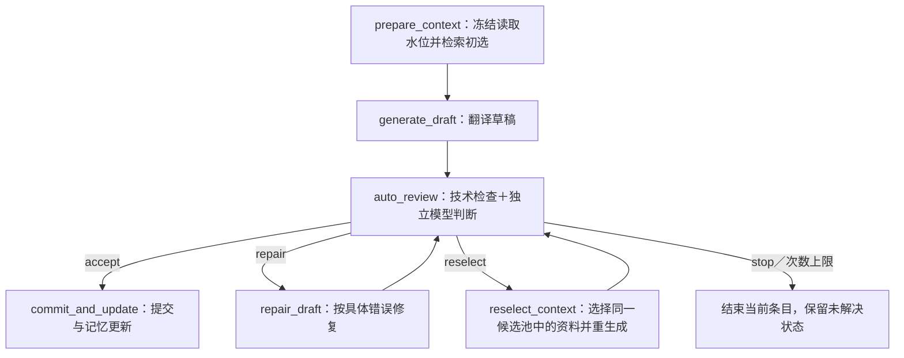

# M5：LangGraph 自主审查闭环

更新：2026-11-10。当前版本删除了人工确认、手填译文与审稿交互菜单，使用远程 DeepSeek Flash 的独立审查调用。研究依据与游戏规范的映射见 [AUTONOMOUS_REVIEW.md](AUTONOMOUS_REVIEW.md)。旧人工运行保留历史记录，不按新策略续跑。

## 流程



一次批次的每条源文使用独立 LangGraph thread_id，共享 M2 run_id 并顺序执行。LangGraph SQLite 保存流程进度，现有 MemoryStore 保存资料、草稿、审查调用、正式译例与提交回执。`check_same_thread=False` 仅用于顺序工作节点在线程池中访问 SQLite，不表示支持同一运行多进程并发写入。

## 主要文件

| 文件 | 作用 |
| --- | --- |
| `workflow/langgraph_game.py` | 状态、六个节点、自动条件路由、停止与提交绑定 |
| `workflow/quality.py` | 技术检查、结构化审查解析、引用验证和策略 hash |
| `workflow/game.py` | 固定输入生成、同上下文修复、显式换上下文重生成、记忆提交回执 |
| `workflow/cli.py` | init/run/status、批次顺序执行、持久化与报告 |
| `prompts/memory/review_autonomous.txt` | 游戏通用语义／格式规范和四动作协议 |
| `run_workflow.py` | 自动选择项目环境，无交互菜单的一键启动 |

## 接口与来源绑定

沿用 Occurrence、ContextPack、ReadView、MemoryRef、TranslationCheck，不新造同义公共对象。GameSession 的 prepare_context／restore_context 固定实际来源与读取水位；generate_draft 以 operation ID 复用已保存结果。repair_draft 默认不换上下文；reselect 节点才显式使用 allow_context_change=True 生成新草稿，源 ID/版本和 run 必须一致。

审查调用 task 为 `review_game_autonomous`，JSON 输出经动作、问题定位和选择边界检查。模型返回的是动作和缺陷，不是译文。reviewer 记录为 `ai:auto-review:实际模型名:调用ID`。初始检索仍使用固定策略／可注入 selector；重选时使用 M3 select_context 的 c01…短 ID 协议，硬项不能删除，数量和 token 预算不变。

当前候选池不足时 stop，不访问网络攻略或猜剧情。所有候选、实际选择与审查观察均保留来源；重选只改证据子集，不解释未知运行时条件为事实。

提交核对自动 accept 的草稿 ID/版本、目标 hash、实际上下文 hash 和策略 hash，重新检查技术约束和来源。旧通过状态不能用于新草稿。TM 同事务保存 reviewed_draft，game_review_receipts 保留正常完成结果；TM 已提交而回执未完成时恢复为带警告结果，不重复记忆调用。

没有实现完整 M6 人工锁、规则更新维护或跨进程并发事务协议。外部 API 响应到保存草稿之间崩溃，恢复时仍可能重发请求，不能承诺 API 恰好一次。

## 配置与运行

依赖版本、项目 `.venv` 与预算 tokenizer 继续复用已有配置，不安装训练／正式指标栈。新机器：

```bash
python3.12 -m venv .venv
source .venv/bin/activate
python -m pip install -e '.[workflow]'
python scripts/prepare_workflow_tokenizer.py
```

DeepSeek 模型设置在 `configs/workflow.deepseek.json`，密钥从 `.env` 的 LLM_API_KEY 读取，不写报告。整个运行默认最多 30 次模型调用，跨 CLI 进程累计；无自动 API 重试。预算 tokenizer 为固定 Qwen 代理，不是服务商的精确计费 tokenizer；实际用量另从 API usage 保存。

```bash
python -m localization_agent.workflow.cli init --directory outputs/my-auto-run
python -m localization_agent.workflow.cli run --directory outputs/my-auto-run
python -m localization_agent.workflow.cli status --directory outputs/my-auto-run
```

默认最多两次修复、一次重选，可在 init 时通过 --max-repairs／--max-reselections 配置。init 不覆盖已有目录；run 自动跑到完成、失败或明确停止。进程中断后再次 run 恢复未完成节点，已终止条目不自动重做。

无参数运行 `python run_workflow.py` 自动创建香港时区时间戳目录并运行三条样例，不再使用输入菜单。携带 init/run/status 参数时直接转交 CLI，继续支持从 Conda base／编辑器启动后自动切换项目环境。

新运行固定 workflow_version、review_policy、review_policy_hash；提示词改变需新建运行。旧人工目录只允许 status 查看，删除了 review／interactive 命令及 --edited-target／--reviewer 等交互参数，旧人工通过不会冒充当前自主结果。

## 使用已有实体图

```bash
python -m localization_agent.workflow.cli init \
  --directory outputs/from-existing-graph \
  --source-db /absolute/path/to/graph.sqlite \
  --graph-snapshot 实际快照名称 \
  --project 实际项目名称 \
  --csv examples/workflow_flare.csv
```

对源数据库只读备份，CSV 只选择任务并核对原文，来源版本／metadata 从数据库读取，不覆盖组员资料。新 run 不继承其他实验的译例。默认三条 CSV 演示没有自动抽取的实体边，使用词法／运行内记忆回退。

## 结果与验证

report.html 展示各版草稿、自动决定、缺陷和实际上下文；report.json 保留完整决定、调用与用量；translations.csv 包含失败／未解决草稿，必须按 status 区分已提交结果。新运行不再产生 pending.json。

离线检查覆盖：硬检查不能被模型放行、自动修复与重新审查、重选后上下文绑定、中断恢复、过期源文、非法动作、无效 JSON、修改上限、重复输出停止和提交防重。模拟结果只证明机制。真实小样本记录另见 [AUTONOMOUS_TRIAL.md](AUTONOMOUS_TRIAL.md)。模型自动通过不等于独立人工验收或正式质量收益。
