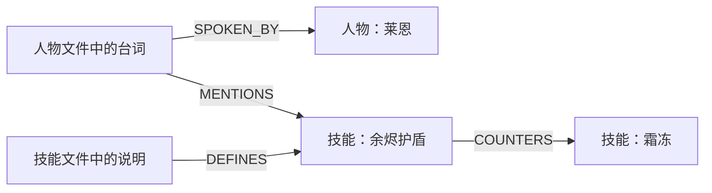

# 无序游戏文本的轻量方案：实体关系图＋五类记忆

更新日期：2026-10-30。状态：**轻量核心已实现；四列独立记录输入，自动建图已有离线实现，真实模型效果待验证**。实际接口、已实现范围和限制见 [GAME_MEMORY.md](GAME_MEMORY.md)，不代表真实游戏翻译效果已经验证。

## 实施更新（2026-10-30）

四列 CSV 桥接、从空实体表发现/跨批次复用、实体间关系候选与单独模型复核、图派生身份/主题及最小逐条翻译记忆集成已实现。实际API、验证与剩余限制见 [AUTO_GRAPH.md](AUTO_GRAPH.md)。本次进一步移除 group_id 和原生组批处理，只按行数分批；完整 LangGraph 工作流、真实模型效果与全局实体维护仍未完成。

## 上游输入边界更新（2026-10-30）

主实验以原始文本及原生资源结构为输入；给实体关系提取 LLM 的 CSV 统一为 `id,source_text,text_type,context`，具体约定与案例见第 4 节。不要求人工填写实体表、speaker_id 或 topic_id，这些身份与关系由 agent 提取并作为内部结果。此前人工登记实体的方式用于接口验证或单列上限实验；自动建图实现及其限制见上方实施更新。评测隔离与输入公平性见 [GAME_EVALUATION_SCHEMA.md](GAME_EVALUATION_SCHEMA.md)。五类记忆的组织思路继续保留。

## 1. 推荐方案

保留现有五类记忆：**术语、摘要、短期记忆 STM、长期记忆 LTM、角色记忆**。增加一张简单的实体关系图，帮助它们找到与当前文本有关的内容。

核心调整只有两件事：

1. **图按实体连接文本，不要求先恢复场景和文件关系。** 人物台词提到一个技能，就可以连接到其他文件里的技能说明。
2. **记忆按当前实体或主题组织，不再把处理顺序当成剧情顺序。** STM 保存近期相关译例；摘要保存这个主题下已经明确的信息。

可以把整体理解为：**实体图负责找关联，五类记忆负责保存和使用不同的信息。** 图不另建一份记忆正文，引用现有文本和记忆记录即可。

本版不再要求先建设 ResourceEntry、ContextUnit、来源联合类型或完整资源 manifest 系统。内部继续用现有 Occurrence 表示文本记录；文件/key、使用位置与源版本按 ID 保留在后台，不作为提取 CSV 的额外必填列。遇到实际引擎需求时再扩展，首版不为所有可能性设计对象。

## 2. 五类记忆全部保留，怎样调整

| 现有记忆 | 无序游戏资源中的组织方式 | 主要作用 |
| --- | --- | --- |
| 术语记忆 | 项目术语表，可关联实体 ID | 统一人物、技能、地点等译名 |
| 摘要记忆 | 按实体或明确主题保存简短的源侧/目标侧概览 | 压缩分散的信息，保持机制描述和表达一致 |
| STM | 当前实体/主题下，最近处理的少量相关已验证译例 | 保持连续工作时的用词和表达习惯 |
| LTM | 当前运行内全部已验证译例，按实体关联与文本相似度召回 | 找回远距离、跨文件的相关译例 |
| 角色记忆 | 按人物保存简短风格笔记，必要时保留已有条件 | 提供说话方式、称呼和语气指导 |

五类记忆是五种用途，不需要五个数据库。STM 和 LTM 继续共用一份译例记录，只是读取方式不同；摘要与角色笔记也继续使用已有 MemoryRecord。

### 2.1 术语：基本不变，补上实体关联

例如 `entity:skill:ember_ward` 对应标准译名“余烬护盾”。不同文件提到该实体时使用同一条术语记忆。

有明确实体身份时优先按实体取术语；没有身份时仍可按已有词面匹配。对于有多种含义的词，不因为字面相同就强行套用某个实体译名。

### 2.2 STM：从“上一段剧情”变为“当前主题的近期工作记忆”

STM 不需要删掉，但应调整语义。

举例：刚翻译完技能文件中的“余烬护盾”说明，现在翻译人物文件中提到该技能的一句台词。即使两句不相邻，前一条已验证译例也可以成为当前 STM 的候选。

建议用现有译例库提供一个简单读取视图：

1. 确定当前文本的主要实体或明确主题。
2. 从本运行已验证译例中，筛选与它相关的记录。
3. 在相关记录里取最近处理的少量条目，例如 3 条；数量不足就返回更少。
4. 切换到另一个无关主题时重新选择，不把前一个主题的 STM 整包带过去。

这里的“最近”是**工作顺序**，不代表游戏事件的先后。给翻译模型的标签写成“近期相关译例”，不能写成“前文剧情”。按实体分组的缓存只是可选优化，不需要维护一套新的持久化记忆对象。

同一实体仍可能跨剧情阶段，因此近期译例仅作为表达参考。已有 branch/phase 等明确条件不兼容时跳过；如果某个例子的使用依赖缺失条件，也不强行使用。没有实体或明确主题的短句，STM 可以为空，其他记忆仍正常工作。

对于确实有顺序的小说、演讲或对话，保留原来的前序 STM。两种模式共用接口，但输入标签与读取策略不同。

### 2.3 LTM：跨文件查历史，避免被“最近 20 条”限制

LTM 仍保存已验证源译对；跨文件查询主要改读取范围，不增加新的记忆类型。

建议先用实体/主题找到相关译例，再按原文相似度排序。实体信息不足时，允许退回项目内的词法或向量检索，但返回的是表达参考，不自动复制译文。

STM 优先解决近期工作的一致性；LTM 解决较早的相关表达。二者去重后再打包。无序模式下，LTM 不应先截断到最近 `ltm_window` 条再搜索，否则很早处理的技能说明依然找不到。

源文件是否已经翻译不影响图上的源文查询：尚未翻译的技能说明可以作为源侧上下文，但还不能作为双语译例。源文检索与 LTM 在输入包中分别标明即可，不需要建立多级 TM 资格体系。首版也不新增自动译文复用功能。

### 2.4 摘要：保留双语，改成主题概览

原先的递进摘要适合“第一段→第二段→第三段”。无序资源更适合“这个技能/人物/任务已经知道什么”。

建议仍保留一类 summary 记录，在内容里增加一个轻量标签，例如 `summary_mode = topic`；关联实体或明确主题。无需新增三种摘要对象。

以“余烬护盾”为例：

- **源侧概览**：技能提供护盾；说明中明确写出的持续时间和触发条件；当前材料存在的冲突或缺失。
- **目标侧概览**：已验证译文采用“余烬护盾”；相关机制表达采用“吸收伤害”等。

源侧概览只概括实际取到的原文；目标侧概览只概括本运行已验证译文，两侧允许覆盖范围不同。继续利用已有 evidence/dependencies 保存参与记录，不为了凑成完整双语摘要而生成尚未翻译内容的“目标记忆”。

更新时，累计一定数量的新资料或新译例再刷新一次，避免每条文本都调用摘要模型。初期从底层相关记录重建短概览，信息量较大时再考虑增量合并；不要无限追加旧摘要，导致条件和歧义逐渐丢失。

摘要提示词强调：**列已知信息，不推断剧情顺序，不补全人物经历。** “同一个人物说过”不等于“发生在同一场景”。只有发现明确对话/章节顺序时，才使用原来的叙事摘要。

### 2.5 角色记忆：角色说话风格与主题事实分开

角色记忆继续保存简短 style note，例如“措辞直接、句子简短、常用军事用语”。主题摘要保存本次相关事实，二者不要重复写成长篇人设。

只知道人物身份时可以使用已批准的基础风格；不知道听话人或剧情阶段时，不猜测亲疏关系、敌友关系和特殊称呼。角色文件中的台词可以用于提出风格候选，但不能把其中一句异常情绪概括成永久性格。

## 3. 图只保留两个核心节点类别

### 3.1 节点

| 节点 | 内容 | 对现有代码的处理 |
| --- | --- | --- |
| 文本节点 | 一条待翻译原文，保留原有 occurrence ID | 直接使用现有 occurrence 节点 |
| 实体节点 | 人物、技能、物品、地点、组织，以及确有需要的任务等 | 使用现有 entity 节点和 entity_type |

术语、摘要、角色笔记可以用实体 ID 查现有记忆表；已有 memory 代理节点也可继续使用，但不要求每条记忆都上图。

现有 document/block/scene 节点不必删除。它们可以继续服务文档模式；无序游戏资源检索不依赖它们，也不必为每个文件构建语义节点。

### 3.2 关系

首版只需要三类文本—实体关系，再加少量真正有用的实体关系：

| 关系 | 示例 | 用途 |
| --- | --- | --- |
| SPOKEN_BY | 一句台词 → 莱恩 | 找角色记忆 |
| MENTIONS | 一句台词 → 余烬护盾 | 找相关实体和资料 |
| DEFINES | 技能说明 → 余烬护盾 | 优先找到解释该实体的文本 |
| 少量带名称的实体关系 | 莱恩 `MEMBER_OF` 组织；技能 `COUNTERS` 技能 | 获取确有帮助的关联知识 |

使用已有 RelationType 注册机制即可。人物可以有多种关系，其他实体也可按实际需求增加关系；不提前建设庞大的游戏本体。关系名称应表达具体含义，避免只有一种模糊的 RELATED_TO。

如果某个任务或事件确实是重要检索入口，可以把它当作普通 entity 的一种类型；不要求所有文本都属于一个任务或场景。



检索时从余烬护盾反查 DEFINES，即可读到技能说明。反向查询只是索引查询，不表示关系在语义上对称。文件之间无需额外建立关系。

## 4. 实体和关系怎样提取：只做有用的部分

推荐一个简单流程：**四列独立记录 CSV → 按批次大小读原文 → 提取候选 → 合并明确身份 → 核验后入图**。

### 4.1 给提取 LLM 的 CSV：只保留四列

这份 CSV 只服务实体关系提取，不承担完整的翻译任务、导出或版本管理。目标是保留原文及必要的原生线索，不让数据整理人员提前完成实体发现。

```csv
id,source_text,text_type,context
```

| 字段 | 内容 | 用途与空值约定 |
| --- | --- | --- |
| `id` | 每条文本出现位置的唯一 ID | 必填；提取结果引用它定位证据，同句不同使用位置不合并 |
| `source_text` | 原始待翻译文本 | 必填；不混入背景说明、参考译文或模型改写 |
| `text_type` | 文本用途，如 dialogue、item_name、item_description、skill_name、skill_description、ui_label、system_message | 优先按原生字段映射；无法确定时填 unknown |
| `context` | 少量原生附加信息 | 使用简单的 `键=值; 键=值` 文本；没有信息时留空，不要求嵌套 JSON |

每行独立，不设置 `group_id`，也不加外层对象块、对话组或替代分组字段。相邻行、同一文件与同一批次都不能证明文本属于同一实体或场景。允许根据正文及已有 context 发现跨行关系，但不要求提前整理归属。

不单设 `speaker` 列，也不用一个含义模糊的 `entity_id` 替代它。对话的发话信息放进 `context`，其他类型只填自己的必要线索。非对话没有说话人是正常情况；对话的说话人未知时可以写 `utterance_role=unknown`，不根据文件名猜测。

| context 信息 | 示例 | 使用边界 |
| --- | --- | --- |
| 原生发话信息 | `npc_name=Abasi, Traveling Merchant; utterance_role=player` | NPC 名称来自资源头，player/npc 来自 you/him/her 字段；不能把文件里的所有文本都算作 NPC 台词 |
| 出现条件 | `requires_status=emp_journal_finish` | 保留原始条件，避免提取成无条件事实；条件缺失不代表确认无条件 |
| 明确引用 | `book=books/merchants_journal.txt` | 保留查找相关材料的线索，不直接当成已批准的实体关系 |
| UI 用途 | `panel=audio; option=SFX` | 来自原生面板/控件信息，帮助解释短标签 |

`context` 只保留有来源且影响理解的信息，不复制整份脚本、不人工补背景故事、不加入模型总结。条件与执行后的事件要区分，例如 `requires_status` 与 `set_status` 不能混成同一条件。原始重复条件可保留重复键；这里的键值文本供模型阅读，不在本轮新增通用解析语言。CSV 单元格中的逗号、双引号和换行按标准 CSV 规则转义。

### 4.2 Flare 案例：同一结构覆盖物品、对话与 UI

下面原文及原生线索来自 `artifacts/flare_full_v0.2/raw/` 的固定快照；`t01` 等行 ID 为说明用的简写，不是已生成的数据产物或关系标注。

```csv
id,source_text,text_type,context
t01,Bear Figurine,item_name,
t02,"Wood sculpture of a bear. A ""1"" is carved into the bottom.",item_description,
t03,Be careful on these roads. Those goblins are nothing but trouble.,dialogue,"npc_name=Abasi, Traveling Merchant; utterance_role=npc; requires_not_status=emp_journal_init; requires_not_status=emp_journal_finish"
t04,Thanks for the warning.,dialogue,"npc_name=Abasi, Traveling Merchant; utterance_role=player; requires_not_status=emp_journal_init; requires_not_status=emp_journal_finish"
t05,Sound Volume,ui_label,panel=audio; option=SFX
```

- **物品**：t01/t02 来自 `flare-game/mods/empyrean_campaign/items/categories/quest.txt` 的物品 1009。这是供读者核对的来源说明，不作为模型的外层分组输入。t01 可以用于发现物品实体；仅凭 t02 与 t01 相邻，不能确定描述归属。若正文及 context 证据不足，就保留未链接文本，不强制生成 DEFINES。
- **对话**：t03/t04 来自 `flare-game/mods/empyrean_campaign/npcs/base/abasi/quest_intro1.txt`；NPC 名称来自同目录的 `common.txt`，由 `npcs/abasi.txt` 的 INCLUDE 连接。`him` 与 `you` 分别表示 NPC 和玩家发话，因此 t04 不能产生“由 Abasi 说出”的关系。每条记录已保留自己的发话线索与条件，不要求把整个对话块一起输入，也不根据行序建立对话先后关系。
- **UI**：t05 来自 `flare-engine/src/MenuConfig.cpp` 的音频设置。模型可以不提取任何实体关系；不能为了每行都有图边而虚构游戏人物或地点。

Flare 的 `abasi.txt` 和 `abasi_2.txt` 还会共同引用 `quest_common.txt`。适配时保留不同使用位置的行 ID；人物是否为同一实体由后续身份连接处理，不因原文相同合并文本，也不因资源键不同就必然拆成人物实体。

### 4.3 怎样组装输入，以及哪些内容不放进 CSV

按配置的批次大小读取独立记录，只为控制模型输入长度，不增加外层分组、组号或公共背景包装。保留每条记录的 ID；一条文本在一次遍历中输入一次，不为每行复制相邻名称、说明或整段对话。

模型依据正文、文本用途、已有 context 和已发现的实体候选判断关系。`text_type` 只表示用途，不能证明某条描述属于上一行的名称。删除分组后，模糊描述和省略指代可能无法可靠链接；允许不建立关系，继续保留原文用于检索，不要求人工补齐归属。跨批次复用实体也需要证据，不能按名称或输入顺序强行合并。

不增加 `entity_id`、`relation`、`topic_id`、人工背景或参考译文列。实体、提及与关系是模型输出；文件/key、源版本及使用位置按 `id` 在后台保存，需要追溯 context 时也能找到对应原字段。模型结果应引用具体行 ID，并指出依据来自原文还是原生 context，不能只引用批次号。

这四列是提取输入视图，不是最终翻译提示词。翻译阶段再根据当前原文查询图和五类记忆，不在 CSV 中预先复制所有相关资料。

### 4.4 小模型提出实体与关系候选

每个批次只要求输出：实体名称/类型、原文中的提及、关系类型、相关文本 ID 和依据。复用现有 ChatModel 和候选批准流程即可，不在这一步训练专用抽取模型。

提取顺序建议：

1. 先处理定义明确的技能/物品名称与说明记录，得到小型候选实体表；若使用批准术语，只能来自实验允许的源资料，不能从测试参考译文构造。
2. 再处理人物台词，把已知实体表中的少量候选提供给提取器。
3. 仅在有明确依据时连接关系；不确定的提及可以暂时不连。

这样比先猜每句话属于哪个场景更直接，也不用对所有文件两两比较。

### 4.5 项目内复用身份，但不按同名强制合并

有明确原生身份时优先利用；没有时由系统分配项目内实体 ID，并逐步积累有证据的别名。不要求人工预填实体表；人工实体表仅用于接口验证或单列的辅助实验，不必先做通用实体消歧系统。

例如“ward”可能指两个技能，模型不能任选一个。保留未链接文本，继续使用原文检索；少量影响译名的歧义再人工确认。无须给每种不确定性设计新的记录类别。

保留原有“候选→批准”即可：新增边默认是候选，批准后才参与图检索。已有源文本 ID、引用和版本足够支持首版核验，不扩展一套来源类型系统。

## 5. 一次翻译怎样组合图和五类记忆

以人物台词“If the Ember Ward fails, retreat.”为例：

1. **找到实体**：明确说话人为莱恩，文本提及余烬护盾；场景未知也可以继续。
2. **查图**：反查余烬护盾的定义；必要时取一层有用的实体关系。不从莱恩节点展开他的全部台词。
3. **读五类记忆**：术语取标准译名；摘要取技能主题概览；STM 取近期相关译例；LTM 取较早的相似译例；角色记忆取莱恩的基础风格。
4. **合并输入**：正文去重，同一译例不同时占 STM 和 LTM；保留已有长度预算。缺少的记忆类别直接为空。
5. **翻译并检查**：源说明用于理解含义，目标译例用于表达参考，不把历史译例中的事件当成当前事实。
6. **写回记忆**：通过检查后写入原有译例库，下一次可被 STM/LTM 读取；主题积累到一定规模后刷新摘要。术语与风格变化仍走候选批准。

默认图检索可以从“直接定义＋最多一层实体关系”开始。对人物、常见地点等高频节点限制返回数量；不需要第一版就做 PageRank、社区划分或全图扩散。

同一文本涉及多个实体时，可以都参与检索，但优先取直接影响当前含义的定义和术语。主题组织不必强制唯一，也不需要新增主题分类模型：优先已有明确标签，其次主要实体；没有合适主题就不生成主题摘要。

## 6. 与 DelTA 式增量记忆怎样衔接

仍保留原来的循环：

```text
读取记忆 → 翻译 → 检查 → 写入已验证译例 → 按需更新摘要/术语
```

改变的是读取和汇总的依据：

| 环节 | 有序文档 | 无序游戏资源 |
| --- | --- | --- |
| STM | 前序、兼容的近期译例 | 当前实体/主题下最近处理的相关译例 |
| LTM | 允许的文档历史 | 当前运行中跨文件的相关译例 |
| 摘要 | 已译部分的叙事推进 | 某实体/主题的已知信息与目标表达 |
| 图入口 | 局部文本块和篇章关系 | 当前文本及其明确实体 |

增量更新仍存在，只是不再按文件行号累计剧情。某条源说明或译例更新时，沿已有 evidence/dependencies 使依赖它的摘要失效，再按需要重建；不新增独立的维护系统。

需要注意：**无序输入不等于完全不受处理顺序影响。** 先处理的文本能提供给后续更多目标侧经验。可以先翻译定义清楚的术语/技能说明，再处理引用它们的台词，以减少冷启动问题；这只是工作调度，不表示剧情先后。实验中所有方法使用同一处理顺序，必要时比较几种打乱顺序后的稳定性。

## 7. 代码层面只做必要改动

轻量核心已有项目模式、实体反查、主题记忆及自动建图入口。本次将 `import_benchmark()` 改为四列独立记录，移除分组逻辑，提取与复核模型只收到四个源侧字段。旧 EntityLinker 仍服务已登记实体表；自动发现入口为 AutoGraphBuilder，真实模型效果仍待验证。

| 位置 | 最小改动 |
| --- | --- |
| [schemas/memory.py](../src/localization_agent/schemas/memory.py) | 复用 Occurrence/MemoryRecord；实体关联通过图查询，摘要用 content 中的实体/主题标识，不先增加一组公共对象 |
| [data/benchmark.py](../src/localization_agent/data/benchmark.py) | 接入四列独立记录，按行数分批并保留 context 证据；文件来源与源版本留在后台，不提供分组提示 |
| [retrieval/graph.py](../src/localization_agent/retrieval/graph.py) | 注册 DEFINES；复用实体关系注册和候选批准；不扩展完整来源联合类型 |
| [retrieval/service.py](../src/localization_agent/retrieval/service.py) | 增加实体→定义文本的反查；跨文件找源文；限制高频节点扩展 |
| [memory/service.py](../src/localization_agent/memory/service.py) | 游戏模式 STM 按相关性筛选后取近期，LTM 不再被最近窗口截断；增加主题双语摘要提示词与更新逻辑 |
| [memory/store.py](../src/localization_agent/memory/store.py) | 增加简单的项目运行模式，使一个 run 接收同项目多个文件；沿用原有水位、版本、批准和依赖机制 |

不能只删除现有同文档检查：目前 run 绑定文档、目标记忆按 position 取前序、摘要按 scope 汇总，这几处要一起调整。但调整结果可以很小：一个明确的 `document / game_resources` 模式，加两套读取策略；无需再引入项目资源清单、使用位置注册表和多层导出映射。

游戏模式中，document_id 继续记录文件来源，不再自动代表剧情上下文。实体身份不因文件或分支复制；关系确实有分支/阶段限制时，继续使用已有 Scope 表达。

目标记忆也不再要求整个 metadata 字典完全相同。例如技能说明与人物台词可以互为含义和用词参考；角色风格仍只按当前说话人读取。首版只处理已有明确的关键条件，不建立可配置的复杂兼容规则引擎。

## 8. 简化后仍需保留的几个底线

这些直接复用现有能力，不是新增子系统：

- 相同原文的不同 CSV 记录保留不同 ID，不因文字相同合并。
- 只有已验证译文进入目标侧记忆；不同实验 run 的译文记忆不混用，测试参考不进入在线系统。
- 有明确分支/阶段条件时尊重条件，缺场景时不让模型自行补剧情。
- 源文或依赖更新后，相关摘要和译例按已有机制失效。

首版仍按原始 key 输出一条译文。如果后来发现同一 key 的多个实际用法确实需要冲突译法，单独提出人工处理即可；不以预先构建使用位置体系为开工条件。

## 9. 怎么分步实现和判断是否值得

### 第一步：先跑通跨文件的实体检索

只实现文本—实体链接、DEFINES 反查、项目内实体复用和跨文件源文读取。拿几份小型人物/技能 CSV 验证：没有场景标记时，台词能找到正确的技能定义。

### 第二步：调整五类记忆的读取与更新

术语和角色笔记沿用已有逻辑；调整 STM/LTM 的候选范围与排序；摘要改成主题概览。人工明确的实体链接仅用于接口验证；主实验接入四列 CSV，先完成实体发现、链接和核验，再让图中的实体组织记忆，不把人工关系答案混入主输入。

### 第三步：小样本比较，暂不训练新模型

建议先用约 100–300 条资源，包含跨文件引用、歧义短句和无场景文本。比较：

| 方法 | 要回答的问题 |
| --- | --- |
| 当前系统 | 文件/行顺序假设目前造成哪些问题 |
| 调整组织后的五类记忆，无图 | 简单的相似检索已经能解决多少问题 |
| 调整后的五类记忆＋轻量实体图 | 实体桥接是否额外改善定义召回与译名一致性 |

保持相同翻译模型、处理顺序和上下文预算；记录必要证据是否找到、术语是否一致、是否编造剧情，以及总调用成本。离线流程样例只能验证机制，不能作为翻译质量提升的结果。

如果实体图只增加成本、没有改善必要证据召回，应先修正实体链接或缩小图用途。暂不引入更复杂的图算法，也不立即把 Loong 训练加入这轮改造。等候选组织稳定后，原有 [SFT＋DPO 方案](LOONG_RL_PLAN.md) 再负责从这些候选中做选择。

## 10. 参考思路与结论边界

本版只保留与轻量设计直接有关的借鉴：

- [HippoRAG](https://arxiv.org/abs/2405.14831)：借鉴通过实体连接分散知识的思路；本项目首版使用直接邻接查询，不复现其完整检索方法。
- [TransGraph](https://aclanthology.org/2026.eacl-long.75/)：借鉴图引导翻译上下文选择；明确篇章关系仍用于有序文本，无序资源侧改用实体关联。
- [GNU gettext 的语境机制](https://www.gnu.org/software/gettext/manual/html_node/Contexts.html)：提醒相同字符串可能有不同含义；本版保留独立文本记录和已有元数据，不因此增加完整使用位置模型。

**最值得先实现的组合是：简单实体图＋按实体/主题组织的原有五类记忆。** 它有望缓解无序文本中的跨文件知识缺失、术语不一致和摘要错误串剧情；能否改善最终译文，需要真实样本验证。图和记忆都不能可靠补回原始材料完全没有提供的说话对象或场景信息。
